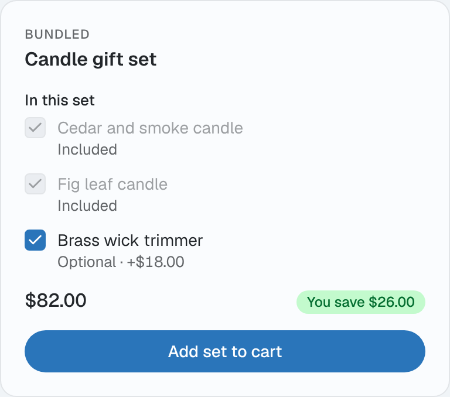
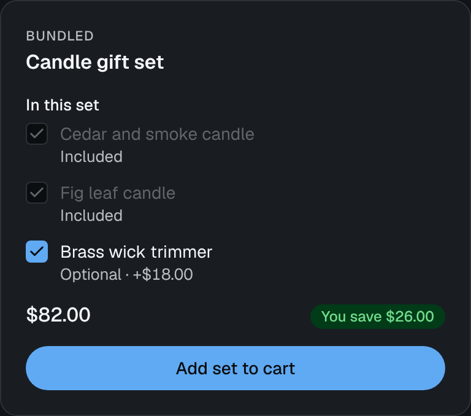

## Design

Bundled product purchase form.

**Light**

**Dark**

### Spec

**Design system components:** Field, Input, Select, Chip, Checkbox, RadioGroup (cards), Table, Badge, Button (solid)

- Sits under the product summary and shares the add-to-cart row (#86).
- Checkbox list: included items are checked and disabled, optional items show their price.
- Total plus a success badge with the saving; "Add set to cart".

**Tokens only:** every color, radius and size comes from `--apui-*` tokens and the component bundle; no DaisyUI classes.

Canvas boards: [PurchaseForms](https://claude.ai/code/artifact/1433c967-7beb-45a4-8e05-e2785d8f8e57#artboard-PurchaseForms) (part of the design for #60).
