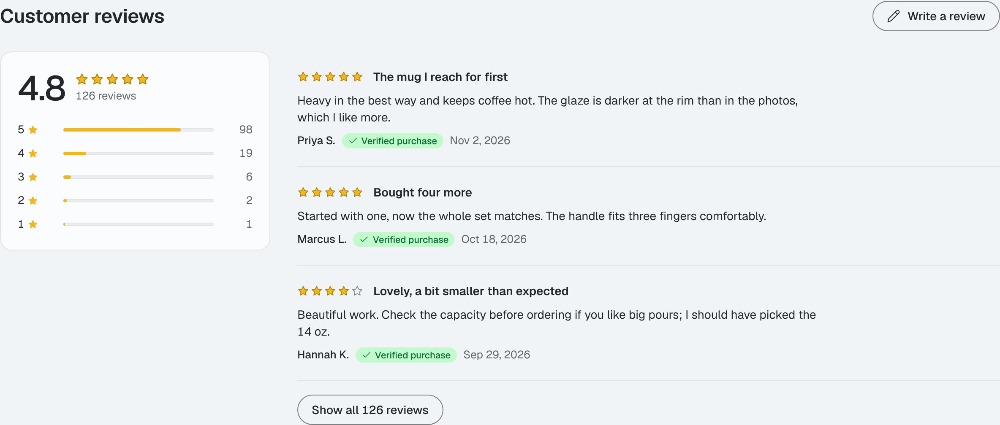

## Design

Product reviews: summary with a breakdown, the review list and the form.

**Product page**

### Spec

**Design system components:** Card, Rating, Progress (sm, accent bar), Badge (Verified purchase), Button, Pagination

- Two columns: a 320px summary card (big average, stars, count, 5→1 breakdown bars that filter the list) and the list.
- Each review: stars, title, body (68ch max), name, "Verified purchase" success badge, date.
- "Write a review" opens the review form (Rating input, title, body, name, email).

**States:** No reviews yet (EmptyState), No reviews with this rating, Submitted: awaiting moderation / published (success alert).

**Accessibility**

- Each breakdown row is a link with "5 stars: 98 reviews (78%)".

**Tokens only:** every color, radius and size comes from `--apui-*` tokens and the component bundle; no DaisyUI classes.

Canvas boards: [Product](https://claude.ai/code/artifact/1433c967-7beb-45a4-8e05-e2785d8f8e57#artboard-Product) (part of the design for #60).
