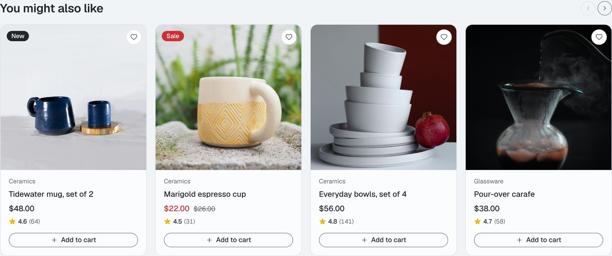

## Design

Related products as a product grid with previous/next controls.

**Product page**

### Spec

**Design system components:** ProductCard, Button (outline icon-only)

- Heading "You might also like"; 4 columns on desktop, 2 on mobile.

**Tokens only:** every color, radius and size comes from `--apui-*` tokens and the component bundle; no DaisyUI classes.

Canvas boards: [Product](https://claude.ai/code/artifact/1433c967-7beb-45a4-8e05-e2785d8f8e57#artboard-Product) (part of the design for #60).
