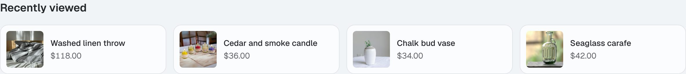

## Design

Recently viewed as compact rows.

**Product page**

### Spec

**Design system components:** Card

- 64px thumbnail, name (one stretched link), price; auto-fill grid with a 240px minimum.
- Hidden when there is nothing to show.

**Tokens only:** every color, radius and size comes from `--apui-*` tokens and the component bundle; no DaisyUI classes.

Canvas boards: [Product](https://claude.ai/code/artifact/1433c967-7beb-45a4-8e05-e2785d8f8e57#artboard-Product) (part of the design for #60).
