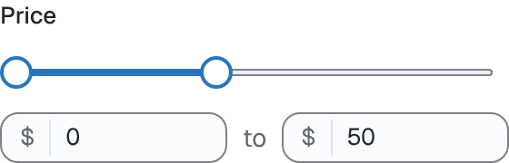

## Design

Price range filter: a two-thumb slider plus min and max inputs.

**Filter**

### Spec

**Design system components:** Range (two thumbs), Input with "$" prefix

- Inputs and thumbs stay in sync; "to" between the inputs.

**Accessibility**

- Each thumb is `role="slider"` with its own label and values; each input has a hidden label.

**Tokens only:** every color, radius and size comes from `--apui-*` tokens and the component bundle; no DaisyUI classes.

Canvas boards: [Filters](https://claude.ai/code/artifact/1433c967-7beb-45a4-8e05-e2785d8f8e57#artboard-Filters) (part of the design for #60).
