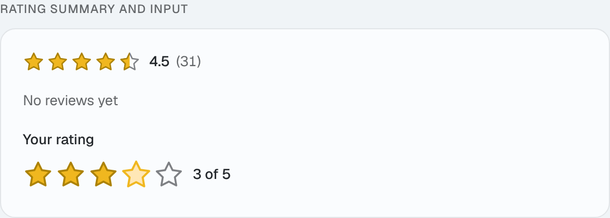
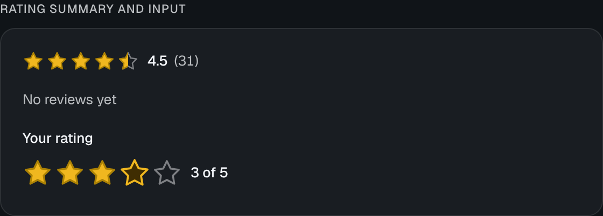

## Design

Star rating input for writing a review.

**Light**

**Dark**

### Spec

**Design system components:** Rating (`data-interactive`, lg)

- 28px stars; hover previews the value; the chosen value shows as "3 of 5".

**Accessibility**

- A radiogroup of five radios ("1 star" … "5 stars"); arrow keys move the value.

**Tokens only:** every color, radius and size comes from `--apui-*` tokens and the component bundle; no DaisyUI classes.

Canvas boards: [Commerce](https://claude.ai/code/artifact/1433c967-7beb-45a4-8e05-e2785d8f8e57#artboard-Commerce) (part of the design for #60).
