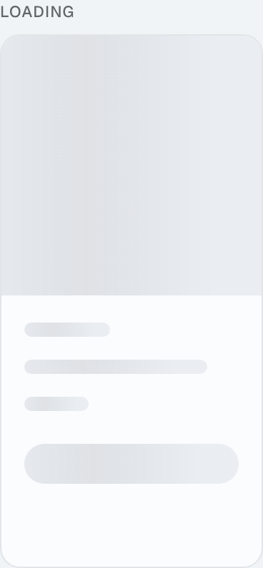
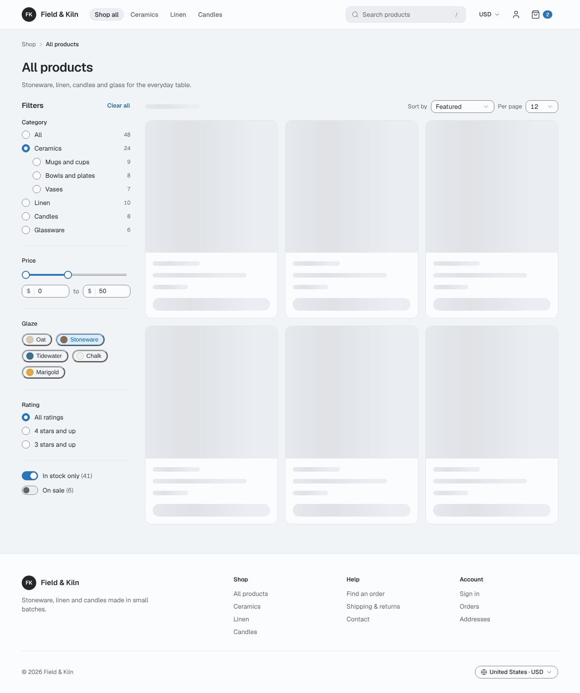

## Design

Skeletons for loading lists and cards.

**Card**

**Catalog loading**

### Spec

**Design system components:** Skeleton (block, text, circle shapes)

- Match the real layout so nothing jumps when content arrives.

**Accessibility**

- Loading regions set `aria-busy`; skeletons are hidden from assistive tech.

**Tokens only:** every color, radius and size comes from `--apui-*` tokens and the component bundle; no DaisyUI classes.

Canvas boards: [CardStates](https://claude.ai/code/artifact/1433c967-7beb-45a4-8e05-e2785d8f8e57#artboard-CardStates), [Catalog-loading](https://claude.ai/code/artifact/1433c967-7beb-45a4-8e05-e2785d8f8e57#artboard-Catalog-loading) (part of the design for #60).
