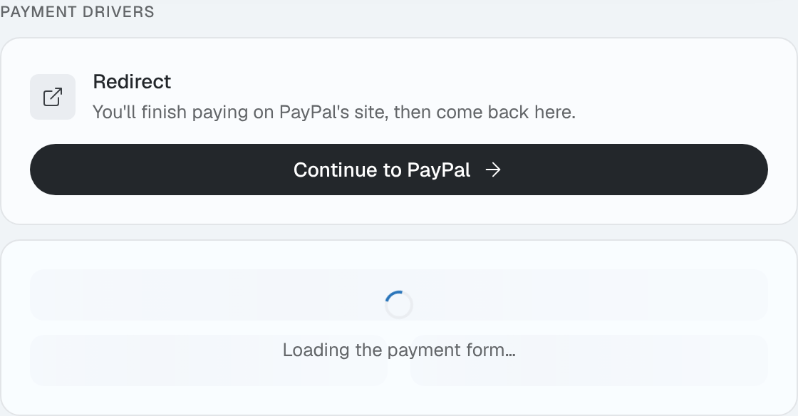
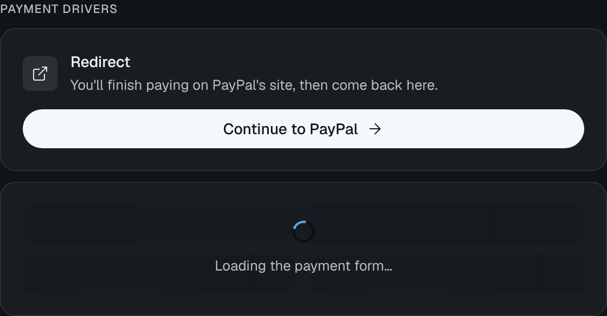

## Design

Redirect payment driver: one line of explanation and a continue button.

**Light**

**Dark**

### Spec

**Design system components:** Card, Icon tile, Button (solid neutral)

- "You'll finish paying on PayPal's site, then come back here." and "Continue to PayPal".

**Tokens only:** every color, radius and size comes from `--apui-*` tokens and the component bundle; no DaisyUI classes.

Canvas boards: [FeedbackSheet](https://claude.ai/code/artifact/1433c967-7beb-45a4-8e05-e2785d8f8e57#artboard-FeedbackSheet), [Checkout-payment](https://claude.ai/code/artifact/1433c967-7beb-45a4-8e05-e2785d8f8e57#artboard-Checkout-payment) (part of the design for #60).
