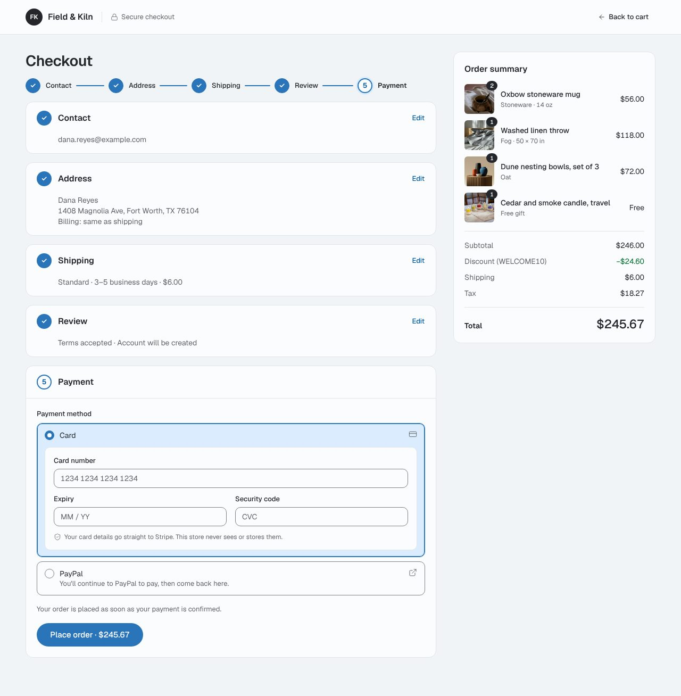
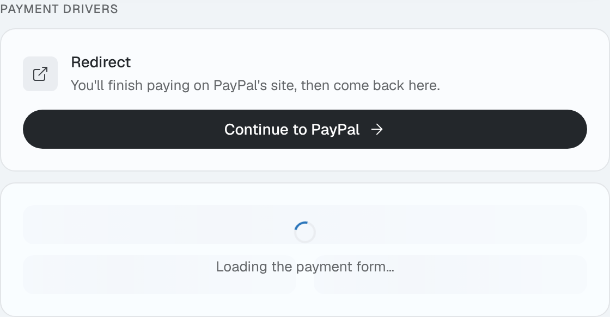
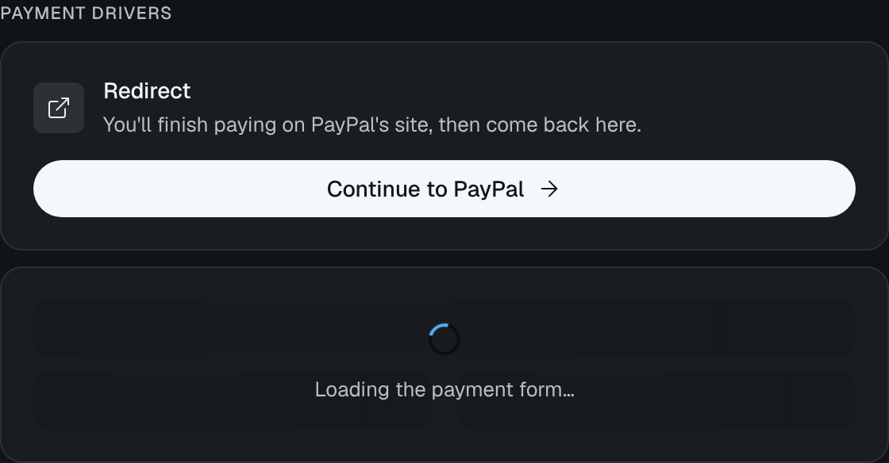

## Design

Stripe Payment Element inside the Card radio card, with a loading state.

**Payment step**

**Loading, light**

**Loading, dark**

### Spec

**Design system components:** RadioGroup (cards), Field/Input (visual match for the Stripe element), Loading overlay, Spinner

- The element sits on `--apui-surface-default` inside the selected card; pass Stripe an appearance object built from the tokens (radius 10px, border, text and focus colors) so it matches the Input.
- Under it: "Your card details go straight to Stripe. This store never sees or stores them." with a shield icon.
- While loading: field skeletons under a glass loading overlay, "Loading the payment form…".

**Tokens only:** every color, radius and size comes from `--apui-*` tokens and the component bundle; no DaisyUI classes.

Canvas boards: [Checkout-payment](https://claude.ai/code/artifact/1433c967-7beb-45a4-8e05-e2785d8f8e57#artboard-Checkout-payment), [FeedbackSheet](https://claude.ai/code/artifact/1433c967-7beb-45a4-8e05-e2785d8f8e57#artboard-FeedbackSheet) (part of the design for #60).
