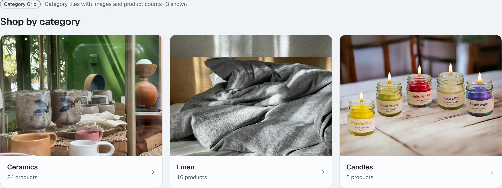
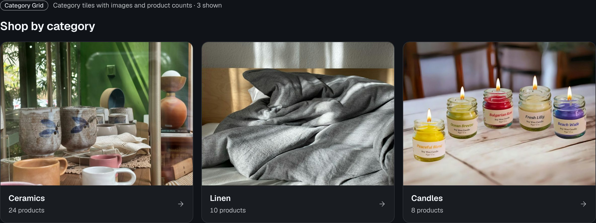

## Design

Category Grid block.

**Light**

**Dark**

### Spec

**Design system components:** Same components as the storefront view it renders

- Category tiles (4:3 image, name, product count, arrow) in 1–6 columns; optional heading.
- Block spacing comes from the editor; the block adds no outer margin.
- Editor-only notices follow the commerce block frame (#91).

**Tokens only:** every color, radius and size comes from `--apui-*` tokens and the component bundle; no DaisyUI classes.

Canvas boards: [BlocksMerch](https://claude.ai/code/artifact/1433c967-7beb-45a4-8e05-e2785d8f8e57#artboard-BlocksMerch) (part of the design for #60).
