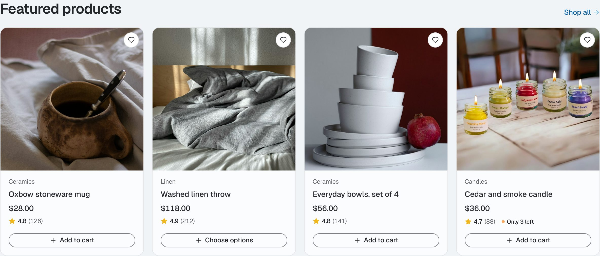

## Design

Featured products pattern: a heading with a "Shop all" link and a 4-column product grid.

**Desktop**

### Spec

**Design system components:** Heading, Link (standalone), ProductCard

- Heading `heading-xl`; link aligned to the end of the heading row.

**Tokens only:** every color, radius and size comes from `--apui-*` tokens and the component bundle; no DaisyUI classes.

Canvas boards: [Patterns](https://claude.ai/code/artifact/1433c967-7beb-45a4-8e05-e2785d8f8e57#artboard-Patterns) (part of the design for #60).
