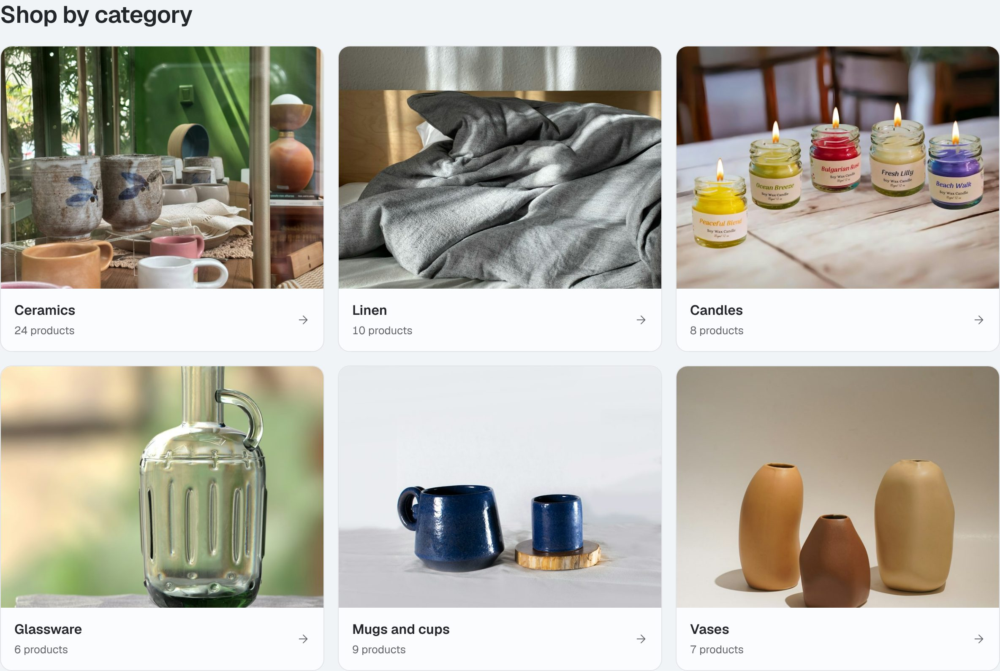

## Design

Shop by category pattern: a heading and the top-level categories.

**Desktop**

### Spec

**Design system components:** Heading, Category Grid

- 3 columns on desktop, 2 on mobile.

**Tokens only:** every color, radius and size comes from `--apui-*` tokens and the component bundle; no DaisyUI classes.

Canvas boards: [Patterns](https://claude.ai/code/artifact/1433c967-7beb-45a4-8e05-e2785d8f8e57#artboard-Patterns) (part of the design for #60).
