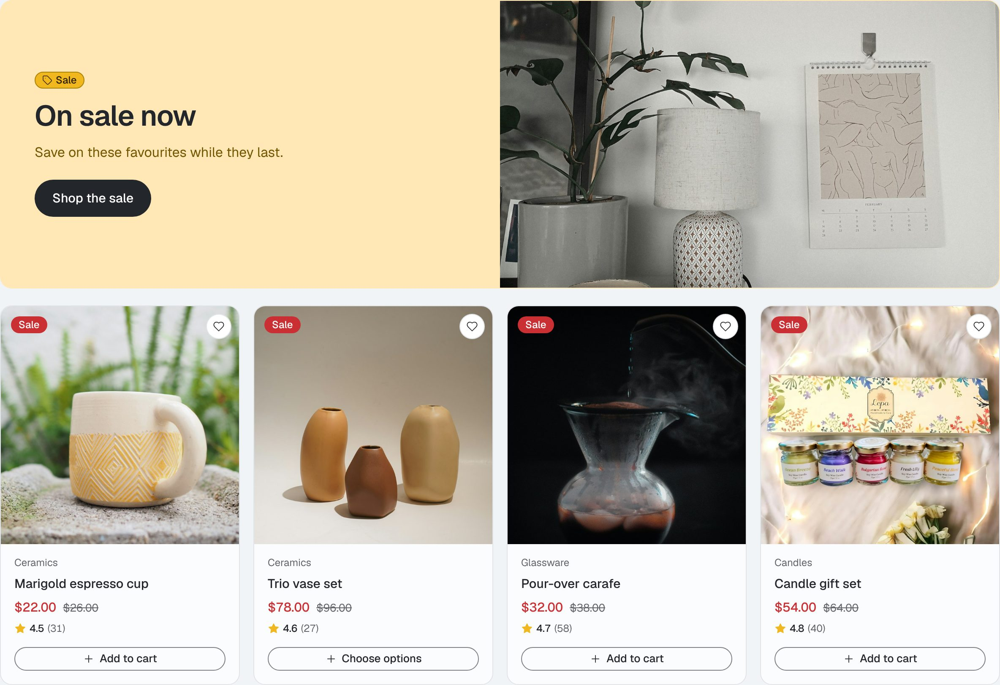
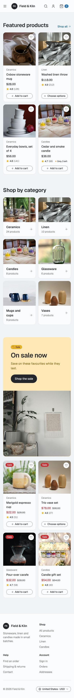

## Design

Sale banner + grid pattern: an accent banner above on-sale products.

**Desktop**

**Full page, mobile**

### Spec

**Design system components:** Card (accent soft fill, no edge), Badge (solid accent), Button (solid neutral lg), ProductCard

- Banner: copy on the start half, image on the end half; stacks on mobile.
- This is the one place the accent color is used on the page.

**Tokens only:** every color, radius and size comes from `--apui-*` tokens and the component bundle; no DaisyUI classes.

Canvas boards: [Patterns](https://claude.ai/code/artifact/1433c967-7beb-45a4-8e05-e2785d8f8e57#artboard-Patterns) (part of the design for #60).
