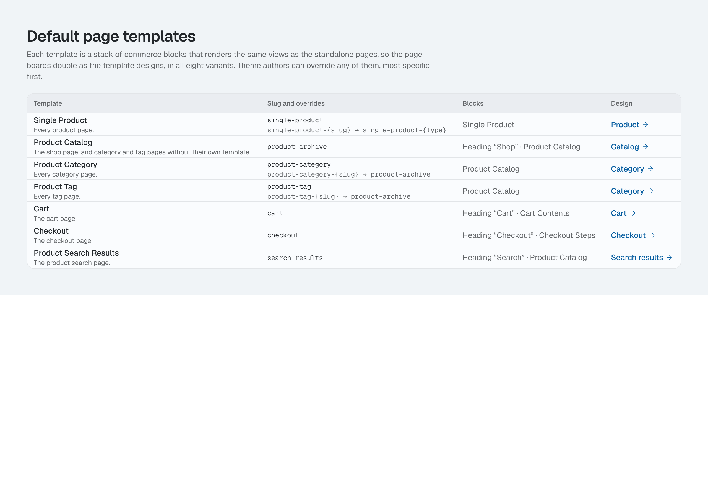

## Design

Default page templates: each template is a stack of blocks that renders the matching page, so the page designs are the template designs.

**Template map**

### Spec

**Design system components:** —

- Single Product → Product page; Product Catalog / Category / Tag → Catalog and Category pages; Cart, Checkout, Search Results → their pages.

**Tokens only:** every color, radius and size comes from `--apui-*` tokens and the component bundle; no DaisyUI classes.

Canvas boards: [Templates](https://claude.ai/code/artifact/1433c967-7beb-45a4-8e05-e2785d8f8e57#artboard-Templates) (part of the design for #60).
