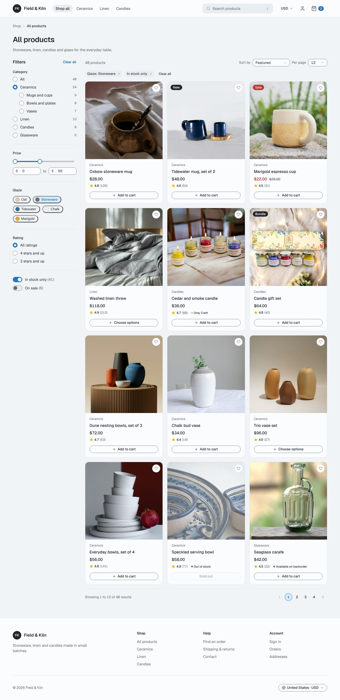
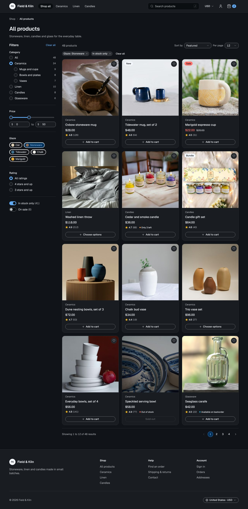
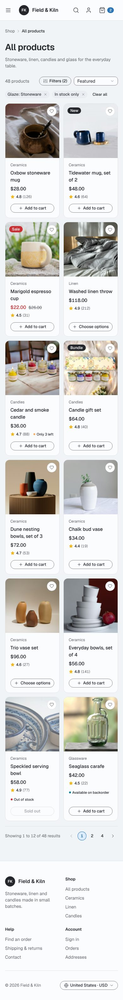
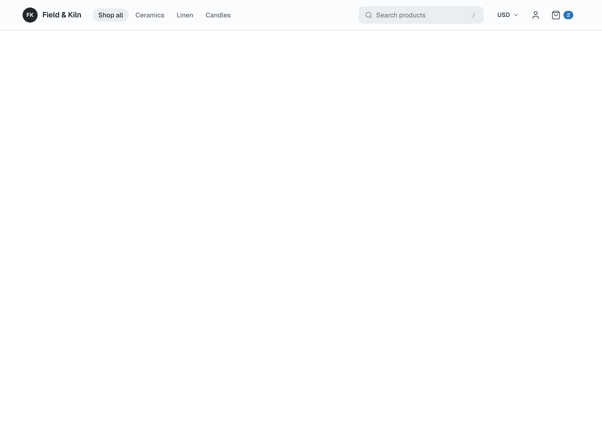
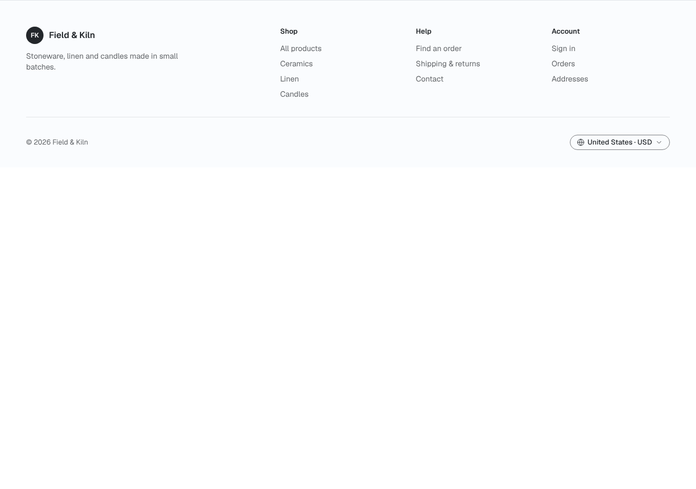

## Design

The storefront layout: header, main content and footer.

**Desktop, light**

**Desktop, dark**

**Mobile, light**

**Header**

**Footer**

### Spec

**Design system components:** Header, Footer, Navbar parts, Input, Button, Badge

- Header: mark + store name, Shop links (desktop), search, currency, account, cart. Mobile: menu button, name, search and cart icons.
- Content max width 1232px with 24px gutters (16px on mobile).
- Footer: about line, Shop / Help / Account links, copyright, region and currency.
- Every page board on the canvas also has dark, high-contrast and right-to-left versions at desktop and mobile.

**Accessibility**

- "Skip to content" is the first focusable element.

**Tokens only:** every color, radius and size comes from `--apui-*` tokens and the component bundle; no DaisyUI classes.

Canvas boards: [Header](https://claude.ai/code/artifact/1433c967-7beb-45a4-8e05-e2785d8f8e57#artboard-Header), [Footer](https://claude.ai/code/artifact/1433c967-7beb-45a4-8e05-e2785d8f8e57#artboard-Footer) (part of the design for #60).
