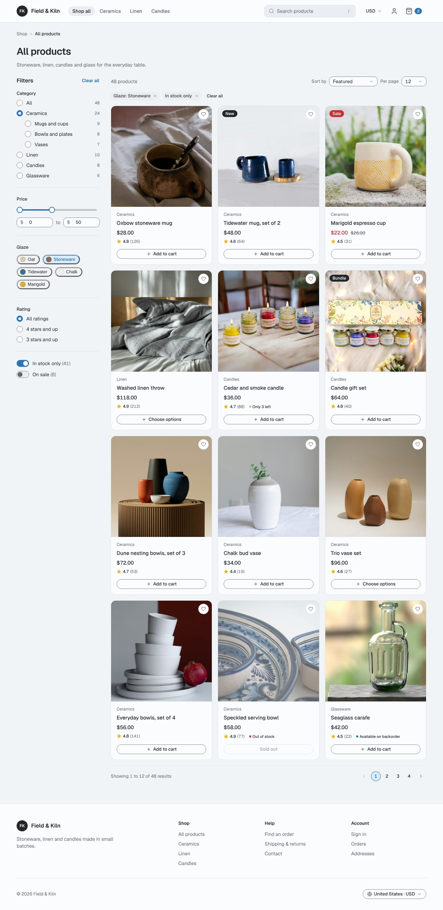
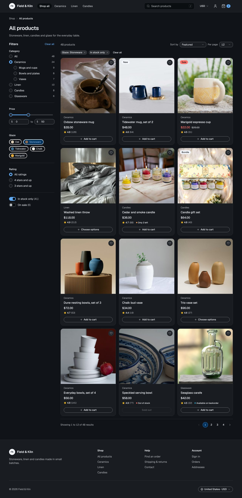
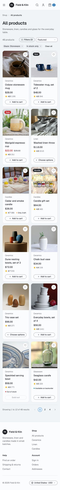
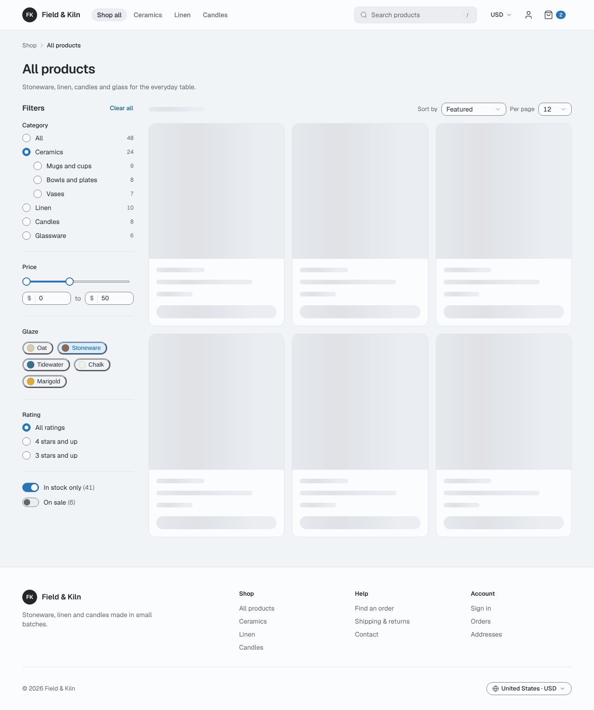
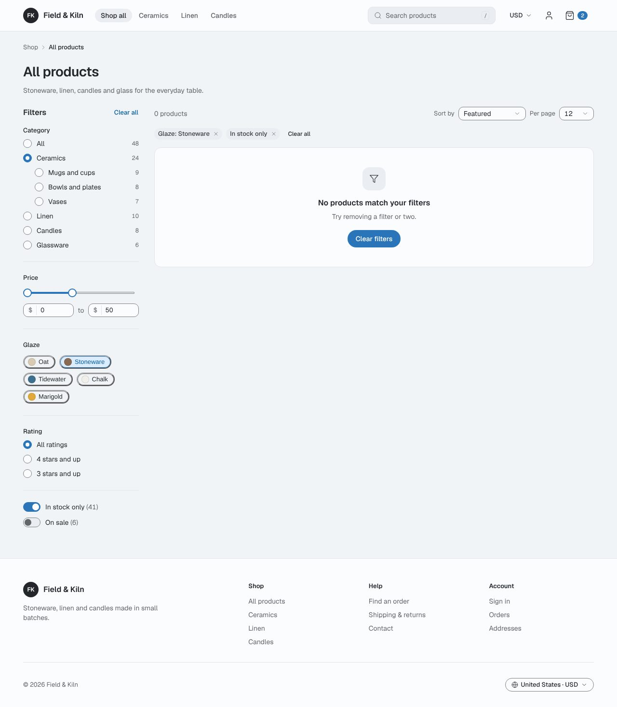
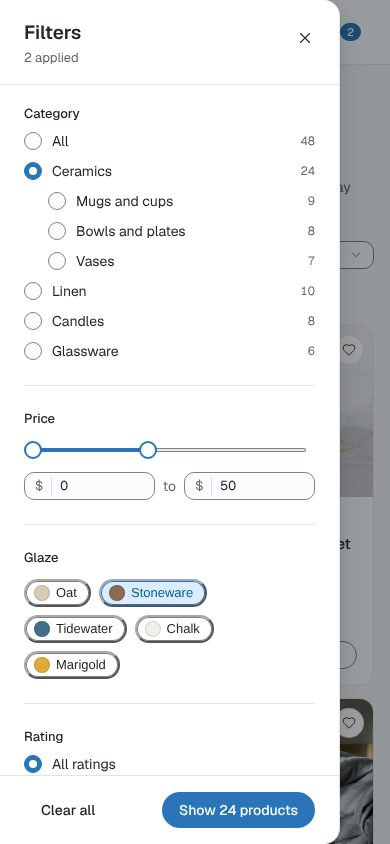

## Design

Catalog page: filters sidebar, toolbar, active filter chips, product grid and pagination.

**Desktop, light**

**Desktop, dark**

**Mobile, light**

**Loading**

**No matches**

**Filters drawer, mobile**

### Spec

**Design system components:** Breadcrumbs, PageHeader, Filters, Select, Chip, ProductCard, Pagination, Drawer

- Sidebar 240px (filters) + grid (3 columns beside filters, 2 on mobile).
- Toolbar: live results count, Sort by, Per page; below 1024px a "Filters (2)" button opens the filters in a start-side drawer.
- Every page board on the canvas also has dark, high-contrast and right-to-left versions at desktop and mobile.

**States:** Loading skeletons, No filter matches, Filters drawer on mobile.

**Accessibility**

- Results count is a polite live region.

**Tokens only:** every color, radius and size comes from `--apui-*` tokens and the component bundle; no DaisyUI classes.

Canvas boards: [Catalog](https://claude.ai/code/artifact/1433c967-7beb-45a4-8e05-e2785d8f8e57#artboard-Catalog), [Catalog-loading](https://claude.ai/code/artifact/1433c967-7beb-45a4-8e05-e2785d8f8e57#artboard-Catalog-loading), [Catalog-nomatch](https://claude.ai/code/artifact/1433c967-7beb-45a4-8e05-e2785d8f8e57#artboard-Catalog-nomatch), [Catalog-filters-mobile](https://claude.ai/code/artifact/1433c967-7beb-45a4-8e05-e2785d8f8e57#artboard-Catalog-filters-mobile) (part of the design for #60).
