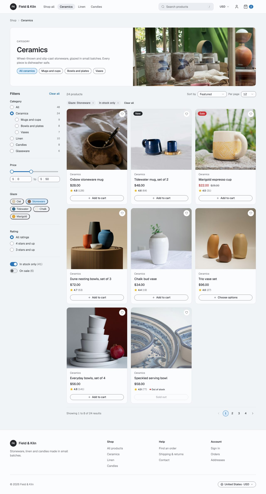
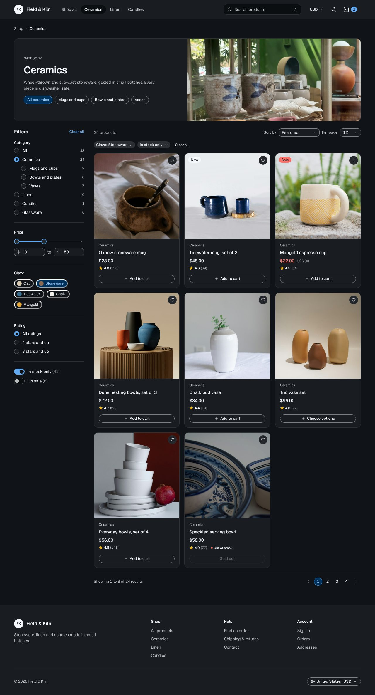
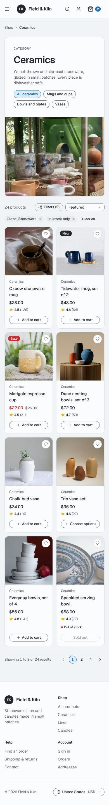

## Design

Tag page: the category layout with the tag name and description; no image or subcategories.

**Desktop, light**

**Desktop, dark**

**Mobile, light**

### Spec

**Design system components:** Same as the category page

- Uses the category page design without the image half and subcategory chips.
- Every page board on the canvas also has dark, high-contrast and right-to-left versions at desktop and mobile.

**Tokens only:** every color, radius and size comes from `--apui-*` tokens and the component bundle; no DaisyUI classes.

Canvas boards: [Category](https://claude.ai/code/artifact/1433c967-7beb-45a4-8e05-e2785d8f8e57#artboard-Category) (part of the design for #60).
