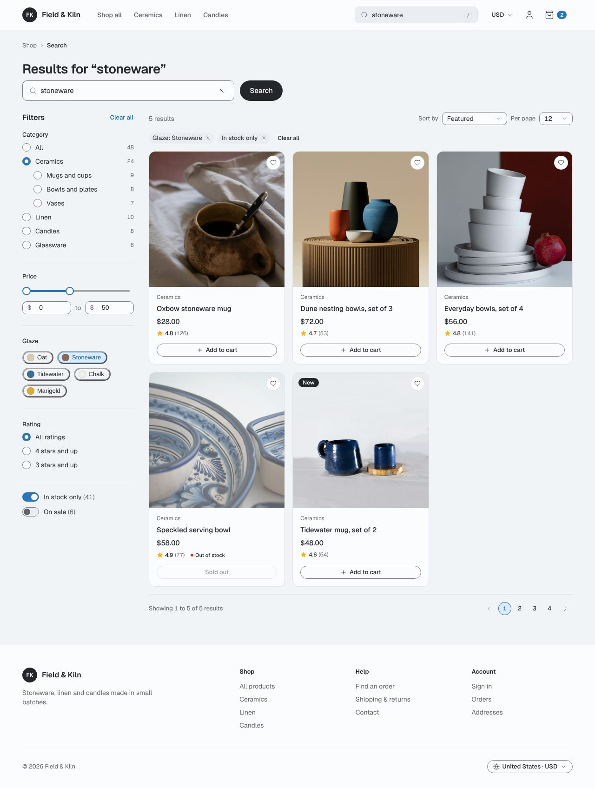
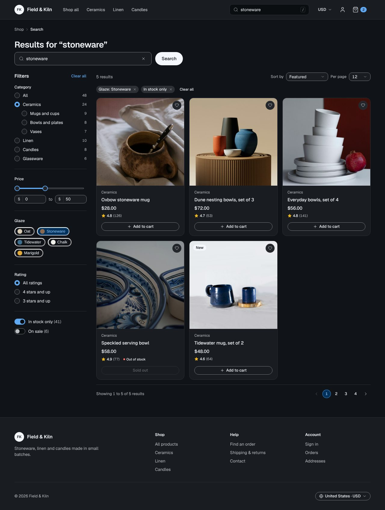
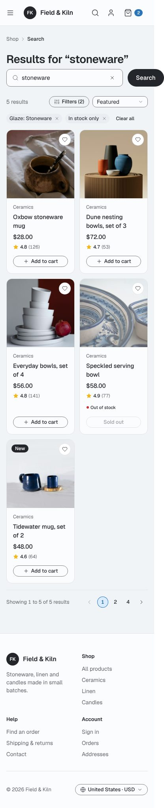
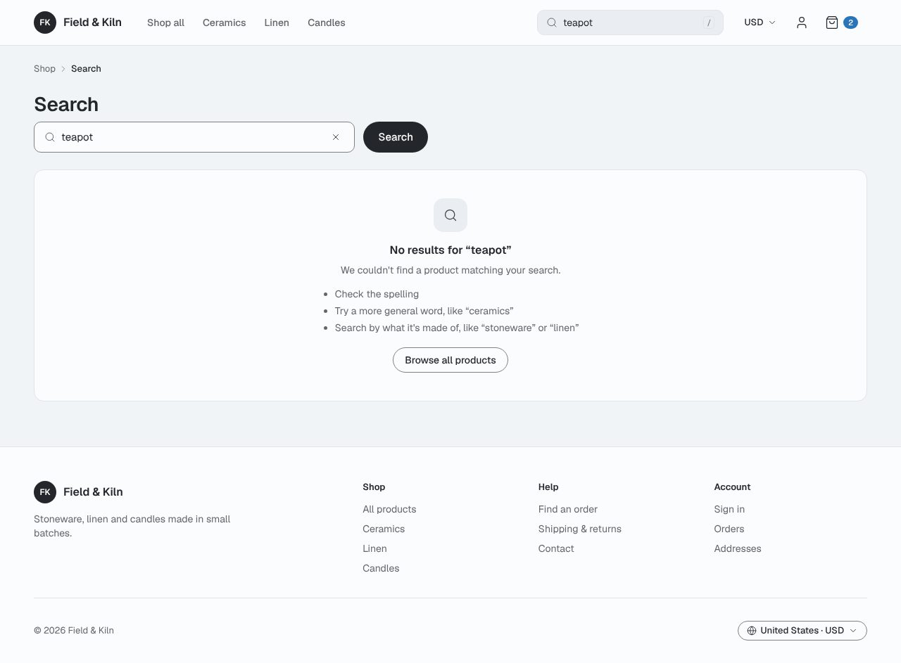

## Design

Search results page: the query in an editable search field above the results.

**Desktop, light**

**Desktop, dark**

**Mobile, light**

**No results**

### Spec

**Design system components:** Input (lg), Button, plus the catalog components

- Title "Results for “…”".
- Every page board on the canvas also has dark, high-contrast and right-to-left versions at desktop and mobile.

**States:** No results: tips list and Browse all products.

**Tokens only:** every color, radius and size comes from `--apui-*` tokens and the component bundle; no DaisyUI classes.

Canvas boards: [Search](https://claude.ai/code/artifact/1433c967-7beb-45a4-8e05-e2785d8f8e57#artboard-Search), [Search-empty](https://claude.ai/code/artifact/1433c967-7beb-45a4-8e05-e2785d8f8e57#artboard-Search-empty) (part of the design for #60).
