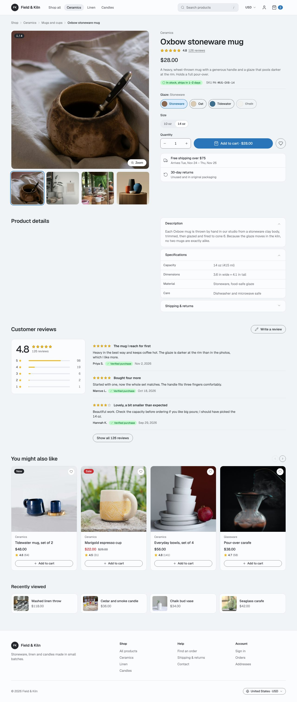
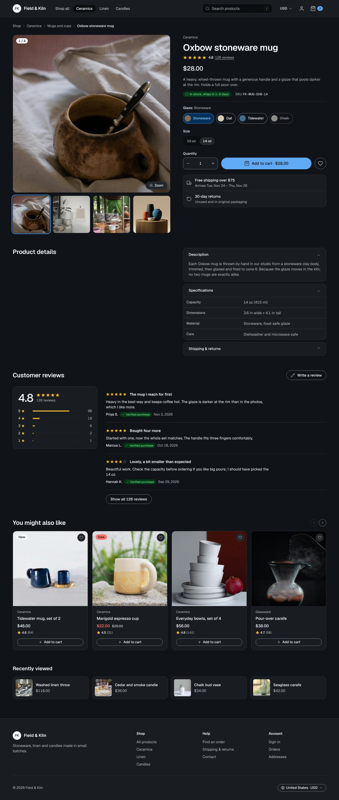
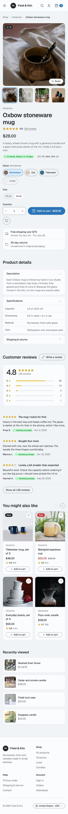
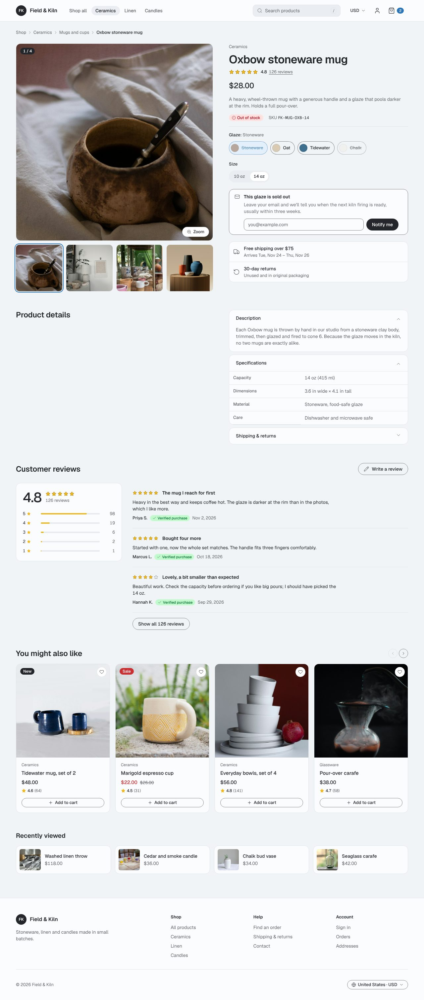

## Design

Product page: gallery, summary and purchase form, details, reviews, related and recently viewed.

**Desktop, light**

**Desktop, dark**

**Mobile, light**

**Out of stock**

### Spec

**Design system components:** Breadcrumbs, Rating, Badge, Chip, Tabs (segmented), Input stepper, Button, List, Accordion, Table

- Two columns (gallery 1.1fr, summary 1fr), stacking on mobile.
- Summary: category link, name (`display-lg`), rating link, price, short description, stock badge + SKU, Divider, purchase form, delivery and returns list.
- Every page board on the canvas also has dark, high-contrast and right-to-left versions at desktop and mobile.

**States:** Out of stock: notify-me alert.

**Tokens only:** every color, radius and size comes from `--apui-*` tokens and the component bundle; no DaisyUI classes.

Canvas boards: [Product](https://claude.ai/code/artifact/1433c967-7beb-45a4-8e05-e2785d8f8e57#artboard-Product), [Product-oos](https://claude.ai/code/artifact/1433c967-7beb-45a4-8e05-e2785d8f8e57#artboard-Product-oos) (part of the design for #60).
