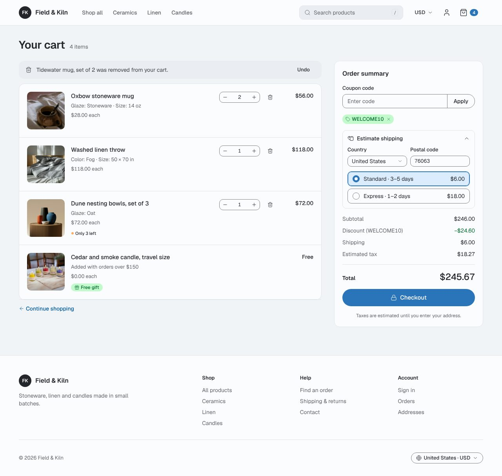
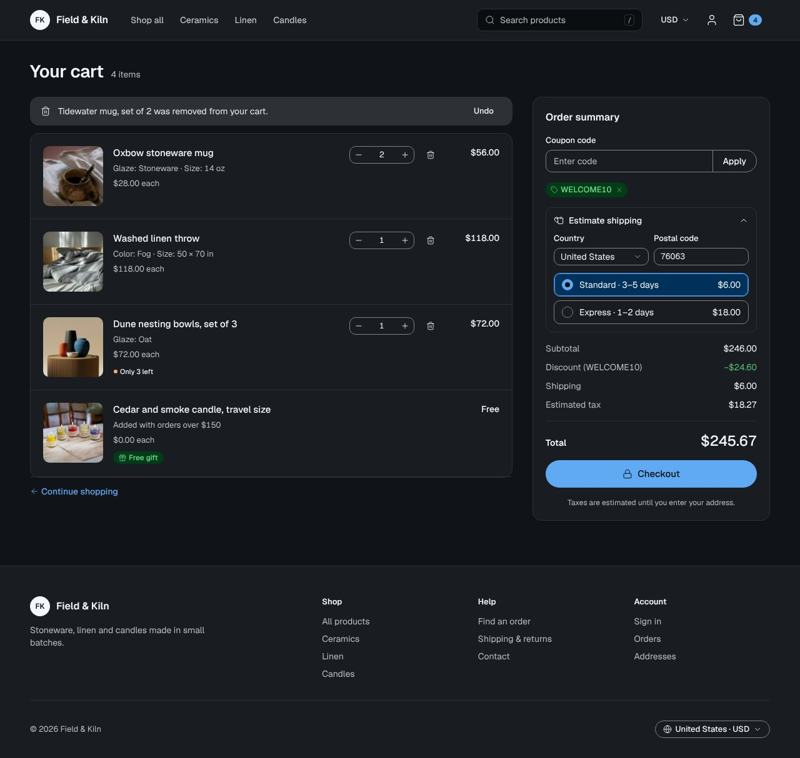
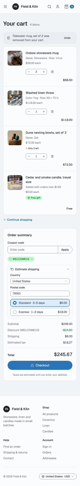
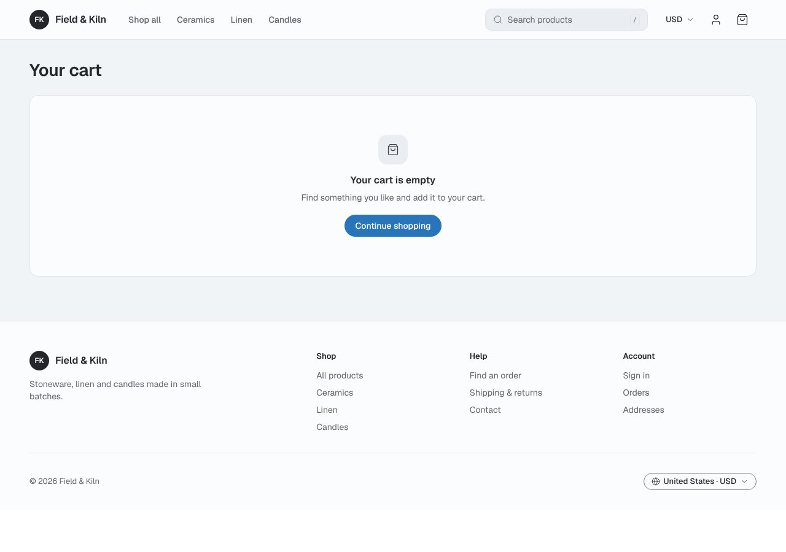

## Design

Cart page: lines and an order summary with coupon and shipping estimate.

**Desktop, light**

**Desktop, dark**

**Mobile, light**

**Empty**

### Spec

**Design system components:** Card, Input stepper, Alert (undo), Input group, Chip, Collapse, RadioGroup (cards), Meta list, Button

- Lines + 380px sticky summary; summary moves below on smaller screens.
- Checkout is the only solid primary.
- Every page board on the canvas also has dark, high-contrast and right-to-left versions at desktop and mobile.

**States:** Item removed with Undo, Low stock line, Free gift line, Empty cart.

**Tokens only:** every color, radius and size comes from `--apui-*` tokens and the component bundle; no DaisyUI classes.

Canvas boards: [Cart](https://claude.ai/code/artifact/1433c967-7beb-45a4-8e05-e2785d8f8e57#artboard-Cart), [Cart-empty](https://claude.ai/code/artifact/1433c967-7beb-45a4-8e05-e2785d8f8e57#artboard-Cart-empty) (part of the design for #60).
