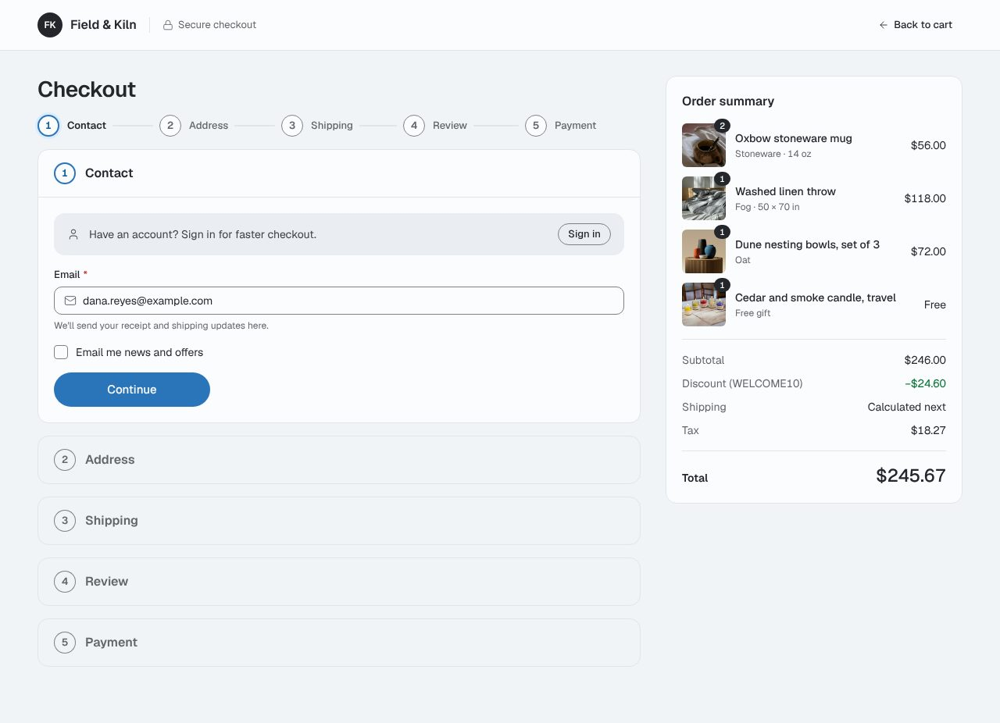
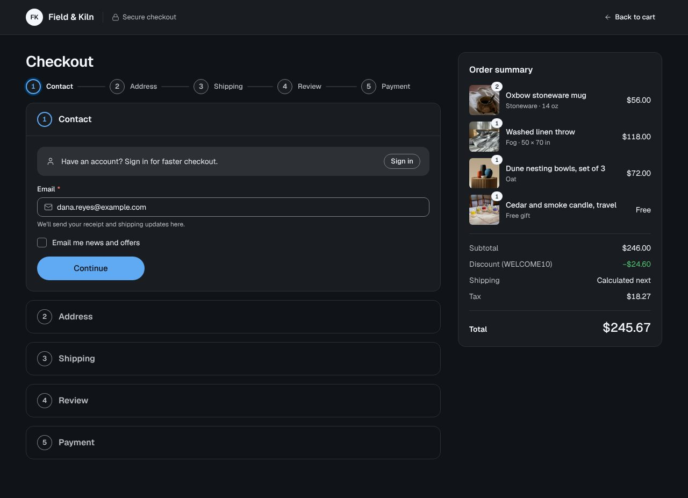
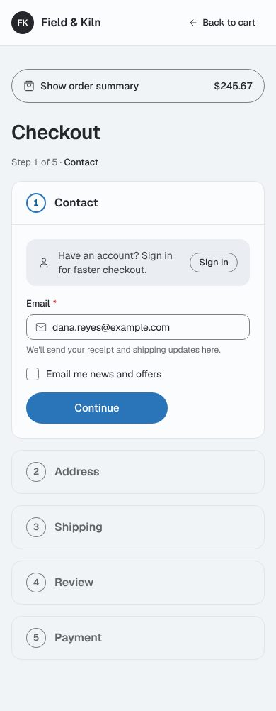
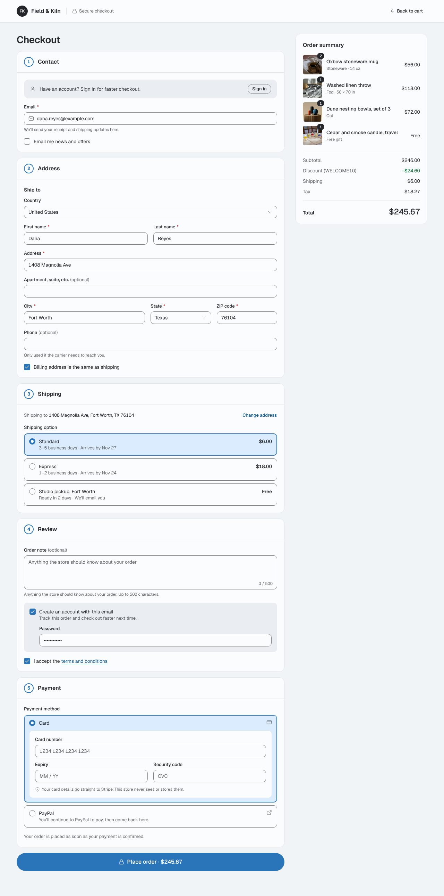

## Design

Checkout page: slim secure header, steps, step cards and a sticky order summary.

**Desktop, light**

**Desktop, dark**

**Mobile, light**

**Single-page layout**

### Spec

**Design system components:** Steps, Card, ValidationSummary, Button

- Done steps collapse to a summary with Edit; upcoming steps sit on the page color with muted titles.
- Mobile shows "Step 2 of 5 · Address" and a "Show order summary" bar instead of the sidebar.
- Every page board on the canvas also has dark, high-contrast and right-to-left versions at desktop and mobile.

**Tokens only:** every color, radius and size comes from `--apui-*` tokens and the component bundle; no DaisyUI classes.

Canvas boards: [Checkout](https://claude.ai/code/artifact/1433c967-7beb-45a4-8e05-e2785d8f8e57#artboard-Checkout), [Checkout-single](https://claude.ai/code/artifact/1433c967-7beb-45a4-8e05-e2785d8f8e57#artboard-Checkout-single) (part of the design for #60).
