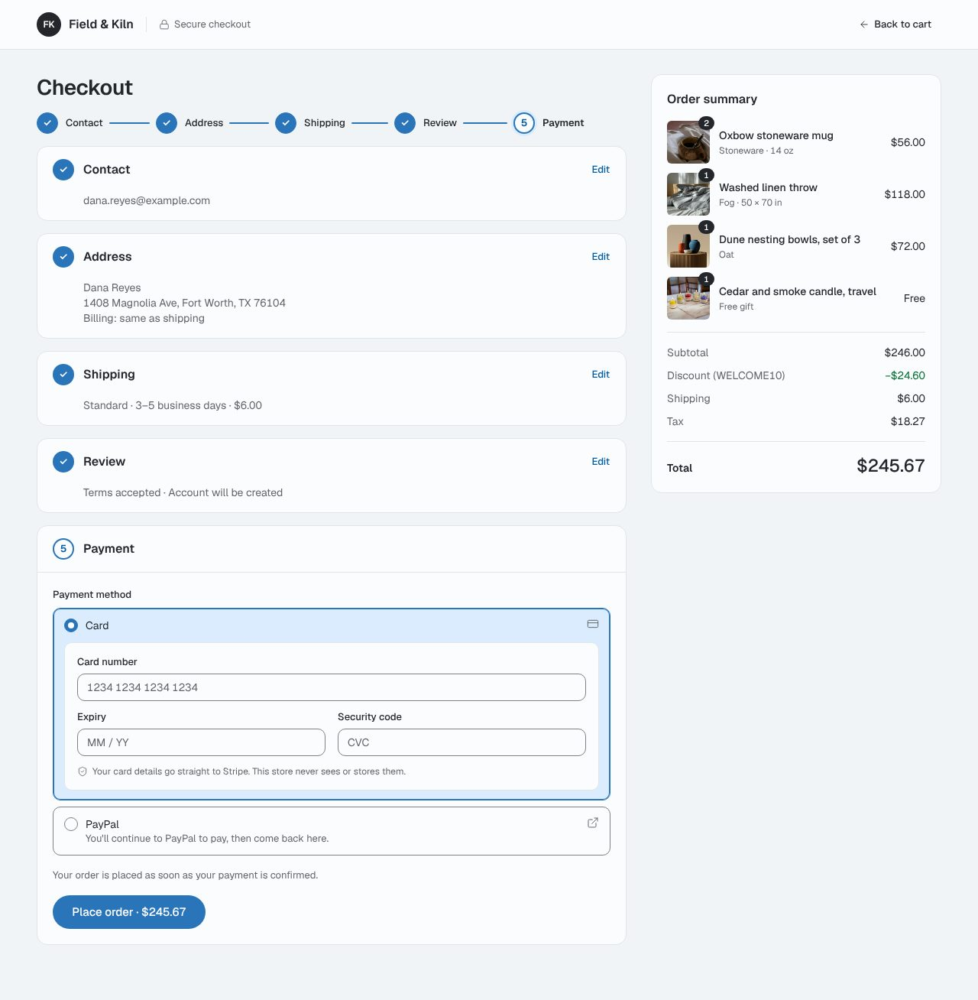
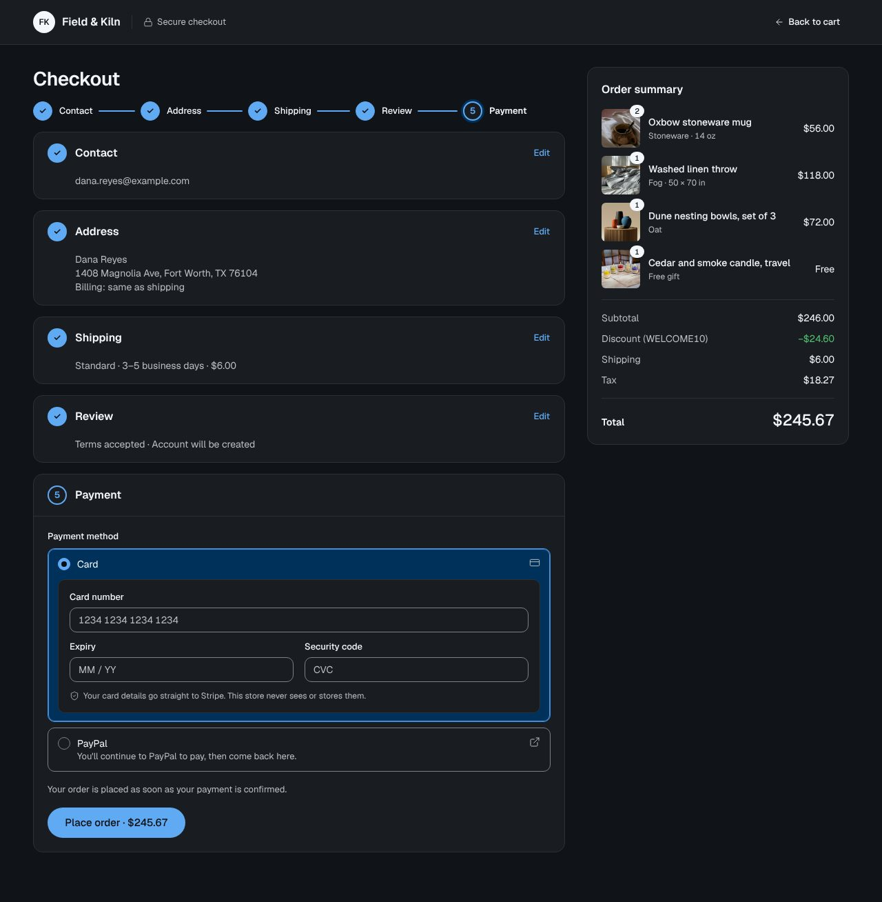
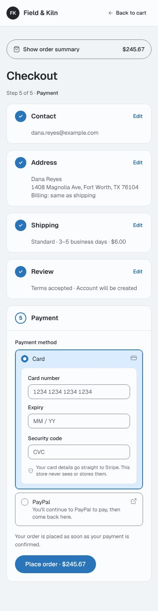

## Design

Payment step of checkout.

**Desktop, light**

**Desktop, dark**

**Mobile, light**

### Spec

**Design system components:** Card, Field, Input, Checkbox, RadioGroup (cards), Button

- Payment methods as radio cards (Card with the Stripe element, PayPal redirect); "Place order · total".
- Every page board on the canvas also has dark, high-contrast and right-to-left versions at desktop and mobile.

**Tokens only:** every color, radius and size comes from `--apui-*` tokens and the component bundle; no DaisyUI classes.

Canvas boards: [Checkout-payment](https://claude.ai/code/artifact/1433c967-7beb-45a4-8e05-e2785d8f8e57#artboard-Checkout-payment) (part of the design for #60).
