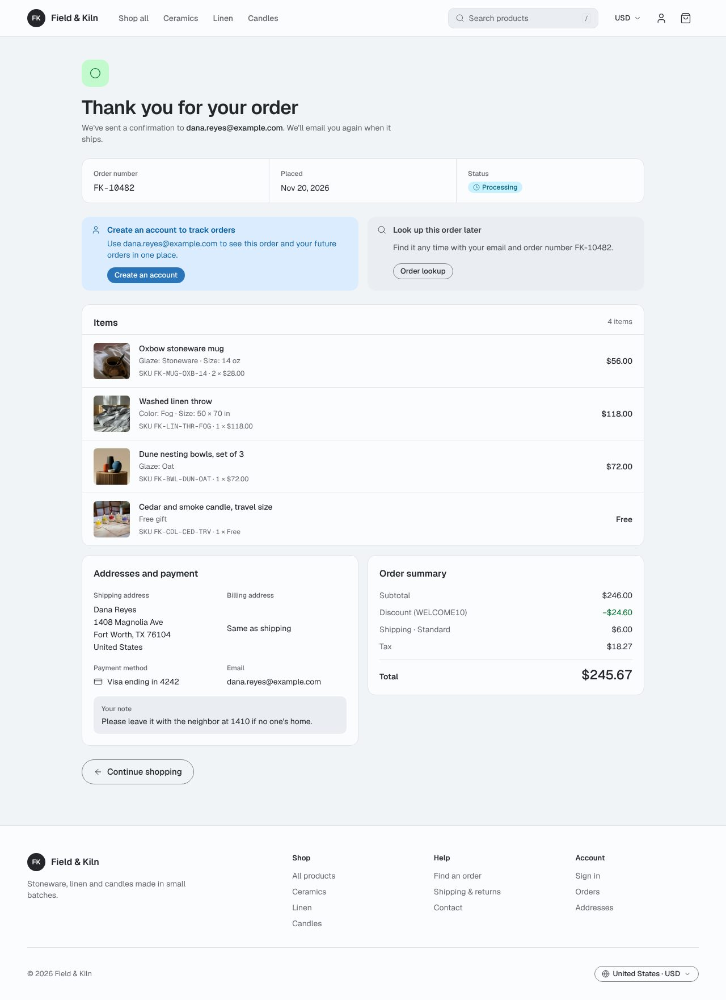
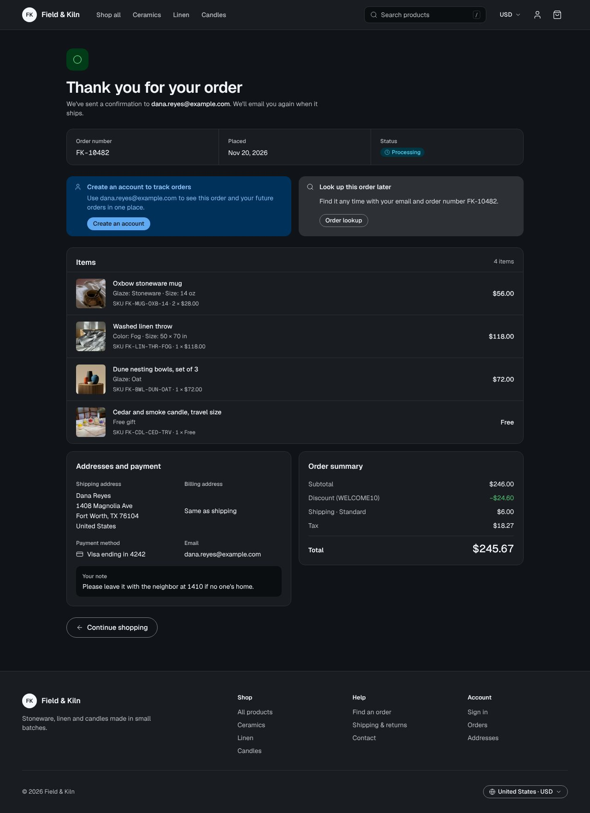
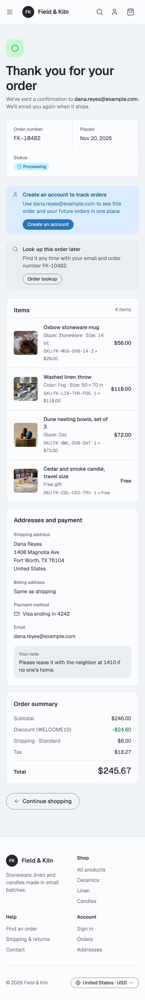

## Design

Order confirmation page.

**Desktop, light**

**Desktop, dark**

**Mobile, light**

### Spec

**Design system components:** Icon tile (success), Card meta strip, Alert, Order details, Button

- Thank-you heading, confirmation email line, order number / placed / status strip, create-account and look-up-later prompts, then order details.
- Every page board on the canvas also has dark, high-contrast and right-to-left versions at desktop and mobile.

**Tokens only:** every color, radius and size comes from `--apui-*` tokens and the component bundle; no DaisyUI classes.

Canvas boards: [Order](https://claude.ai/code/artifact/1433c967-7beb-45a4-8e05-e2785d8f8e57#artboard-Order) (part of the design for #60).
