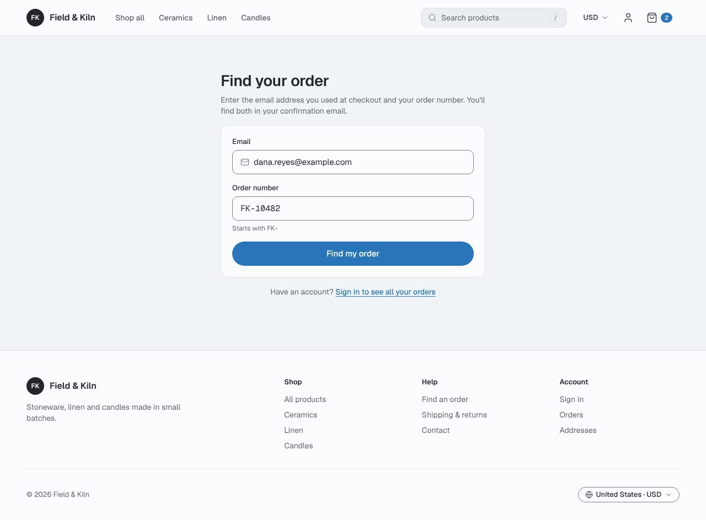
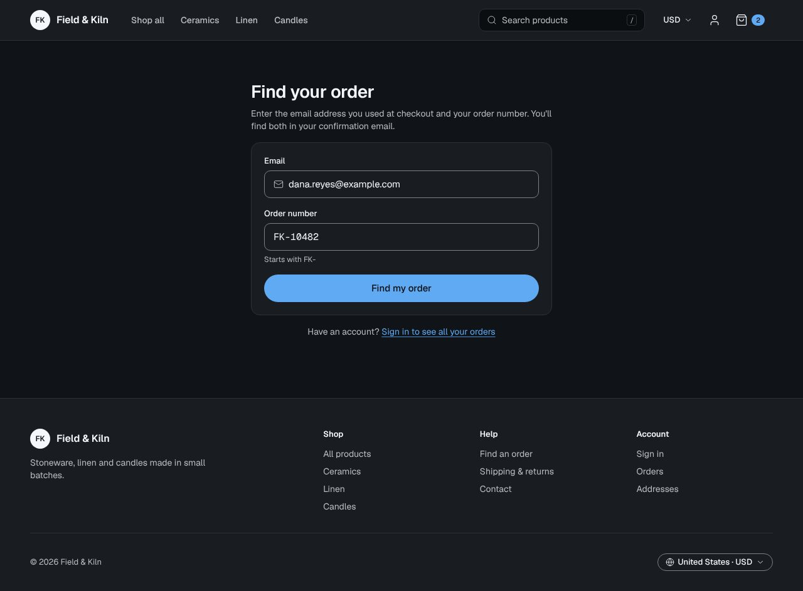
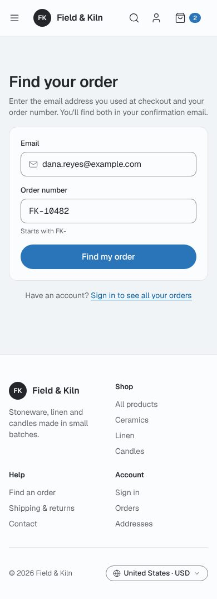
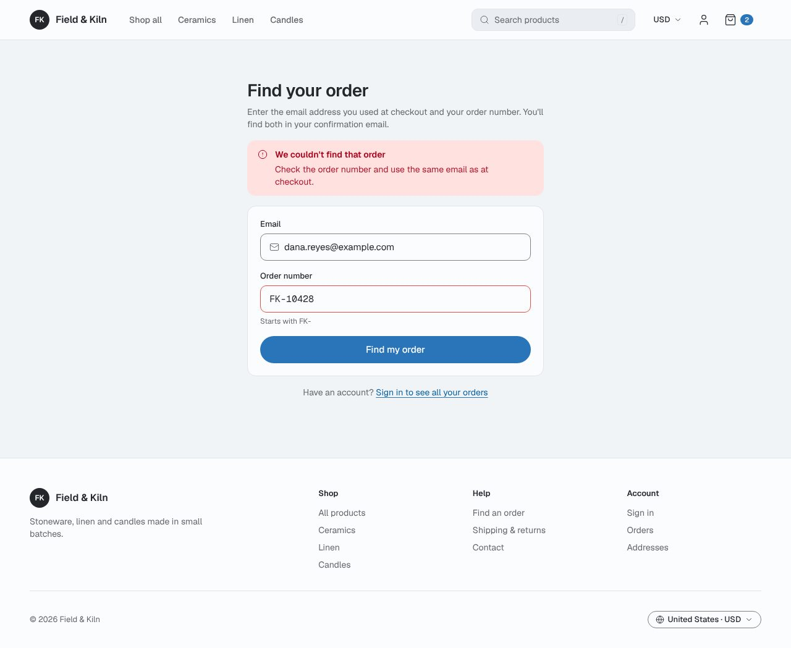

## Design

Guest order lookup page.

**Desktop, light**

**Desktop, dark**

**Mobile, light**

**Not found**

### Spec

**Design system components:** Card, Field, Input (lg), Button, Alert

- Centered 480px form; "Sign in to see all your orders" below.
- Every page board on the canvas also has dark, high-contrast and right-to-left versions at desktop and mobile.

**States:** Not found.

**Tokens only:** every color, radius and size comes from `--apui-*` tokens and the component bundle; no DaisyUI classes.

Canvas boards: [Lookup](https://claude.ai/code/artifact/1433c967-7beb-45a4-8e05-e2785d8f8e57#artboard-Lookup), [Lookup-error](https://claude.ai/code/artifact/1433c967-7beb-45a4-8e05-e2785d8f8e57#artboard-Lookup-error) (part of the design for #60).
