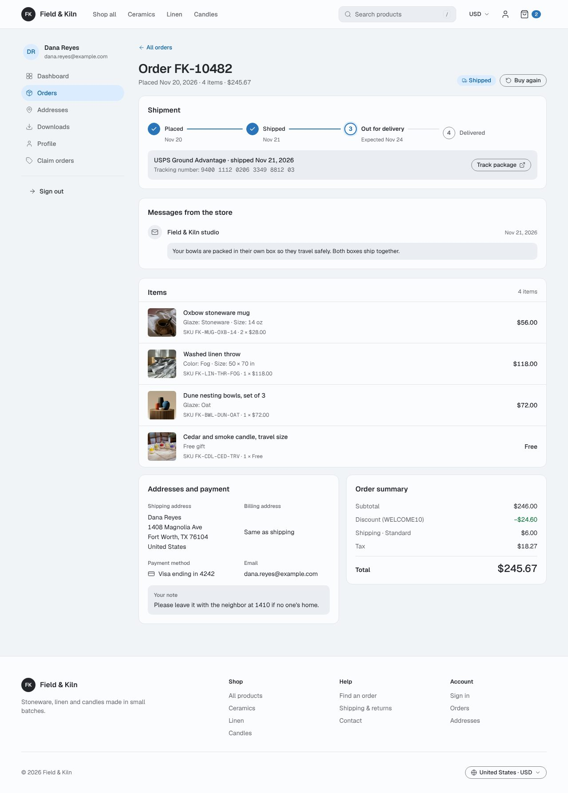
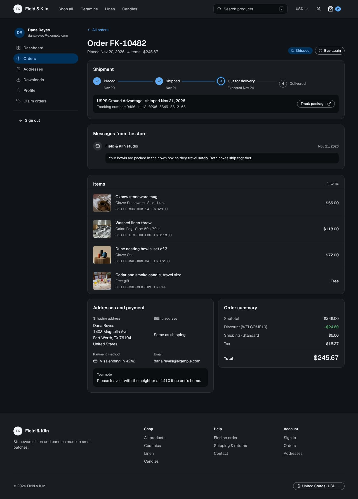
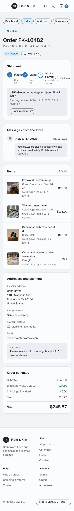
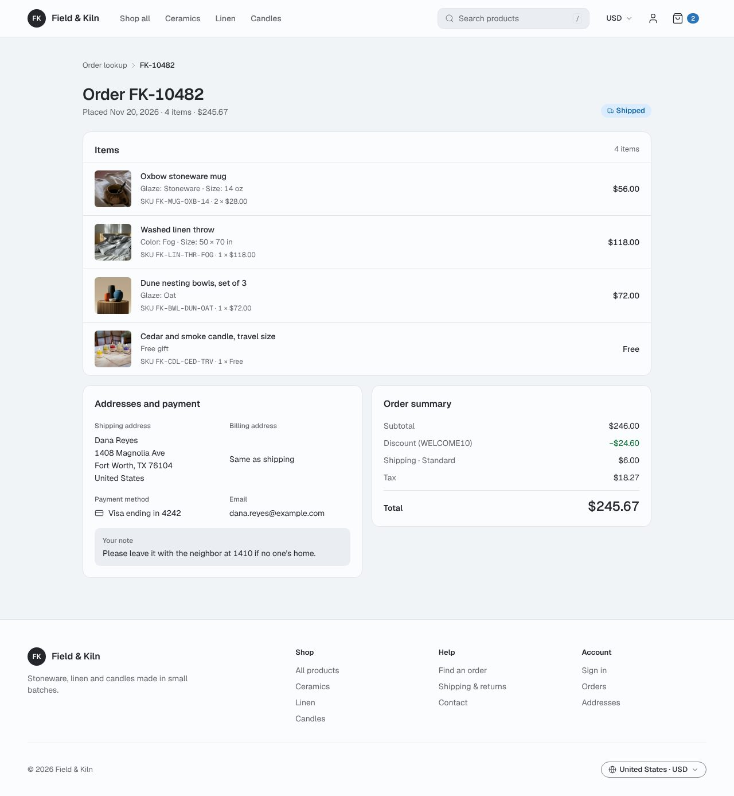

## Design

Order detail page (account and guest).

**Desktop, light**

**Desktop, dark**

**Mobile, light**

**Guest view**

### Spec

**Design system components:** Steps (shipment), Badge, Timeline, Button, Order details

- Header with status badge and Buy again; shipment progress with carrier and tracking; messages from the store; order details.
- Guests see the same details under an "Order lookup" breadcrumb.
- Every page board on the canvas also has dark, high-contrast and right-to-left versions at desktop and mobile.

**Tokens only:** every color, radius and size comes from `--apui-*` tokens and the component bundle; no DaisyUI classes.

Canvas boards: [Account-order](https://claude.ai/code/artifact/1433c967-7beb-45a4-8e05-e2785d8f8e57#artboard-Account-order), [OrderView](https://claude.ai/code/artifact/1433c967-7beb-45a4-8e05-e2785d8f8e57#artboard-OrderView) (part of the design for #60).
