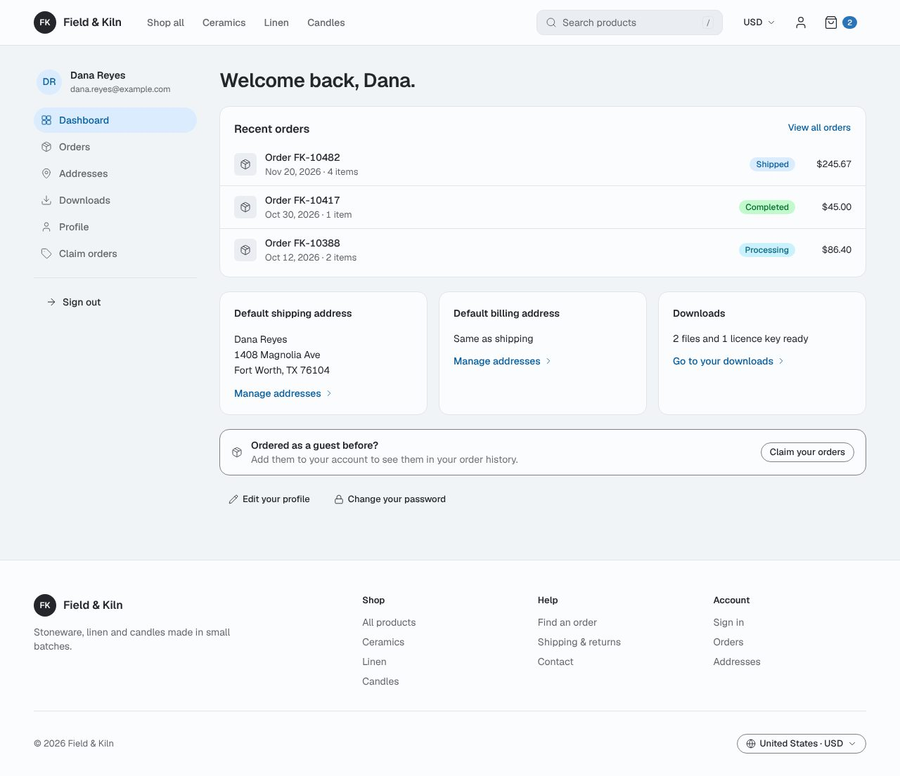
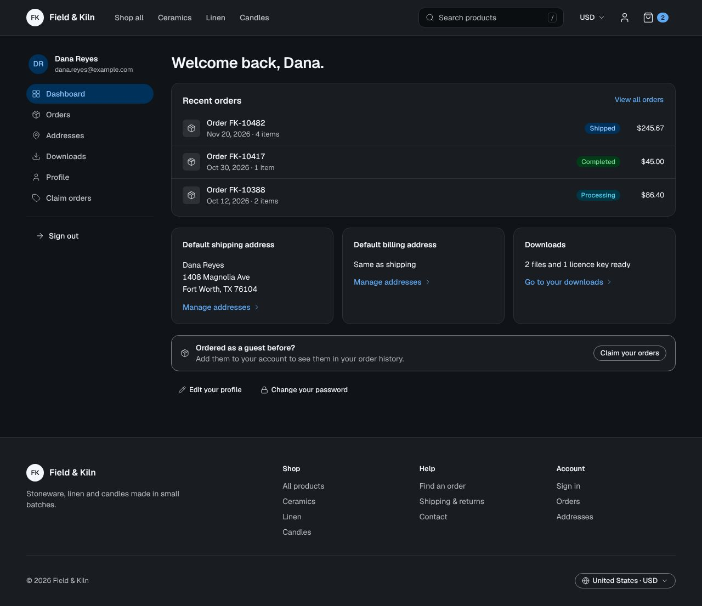
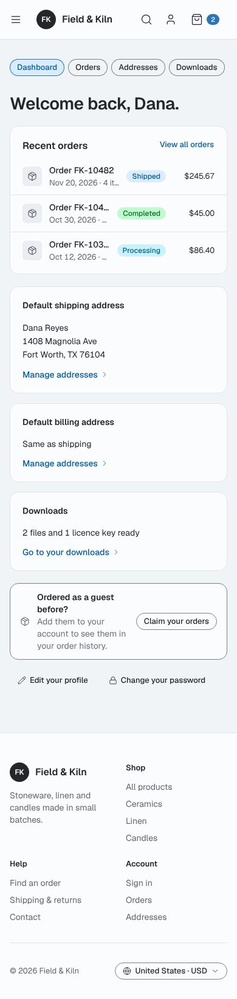
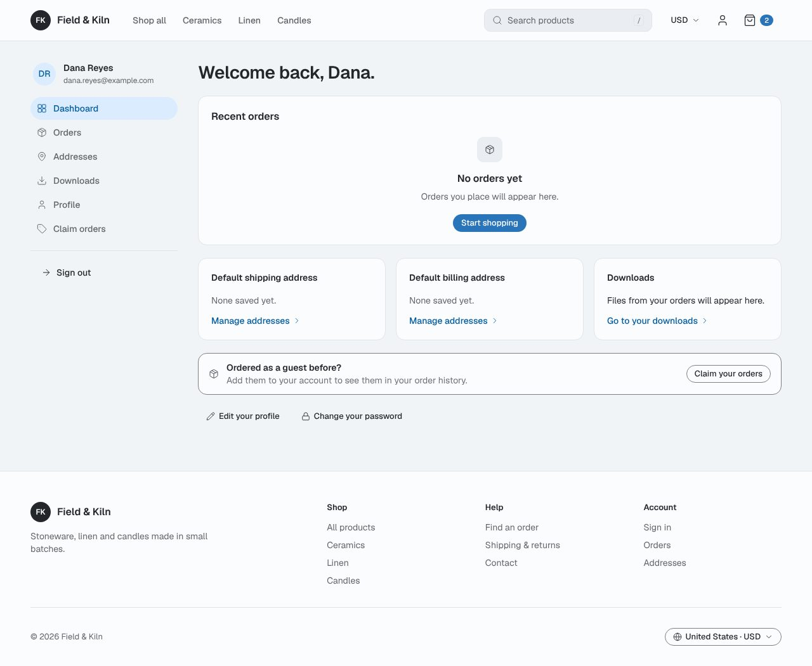

## Design

Account dashboard.

**Desktop, light**

**Desktop, dark**

**Mobile, light**

**New account**

### Spec

**Design system components:** Card, List, Badge, Link, Alert

- Recent orders, default addresses, downloads, claim prompt, profile shortcuts.
- Every page board on the canvas also has dark, high-contrast and right-to-left versions at desktop and mobile.

**States:** New account.

**Tokens only:** every color, radius and size comes from `--apui-*` tokens and the component bundle; no DaisyUI classes.

Canvas boards: [Account](https://claude.ai/code/artifact/1433c967-7beb-45a4-8e05-e2785d8f8e57#artboard-Account), [Account-dashboard-empty](https://claude.ai/code/artifact/1433c967-7beb-45a4-8e05-e2785d8f8e57#artboard-Account-dashboard-empty) (part of the design for #60).
