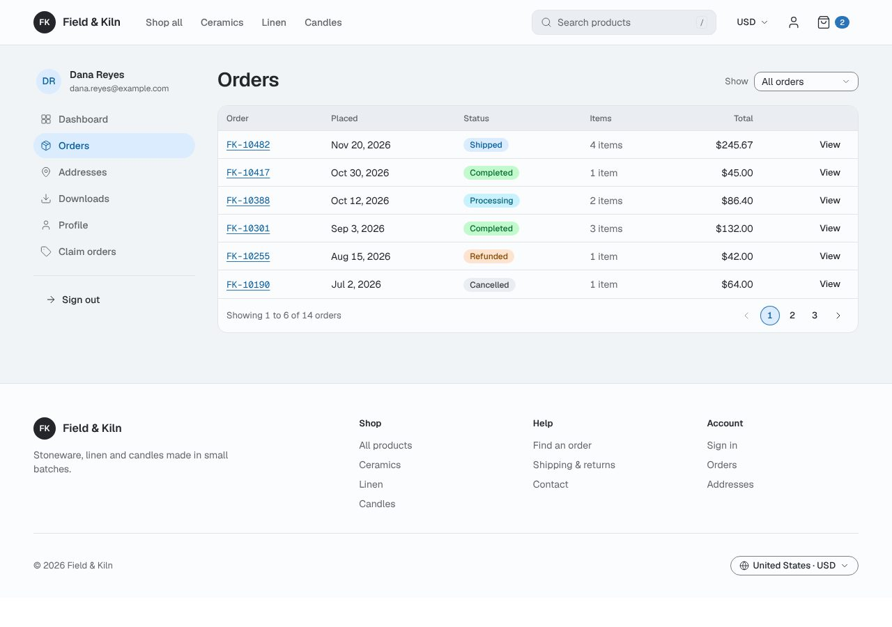
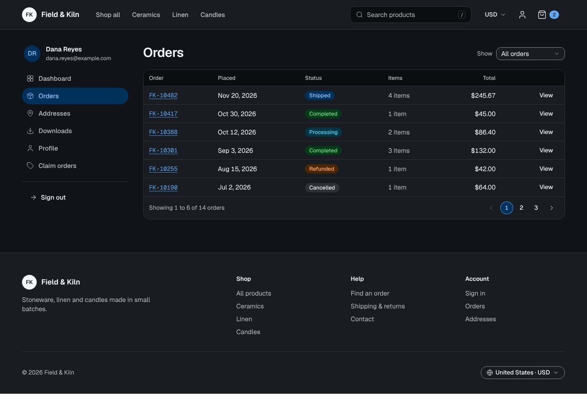
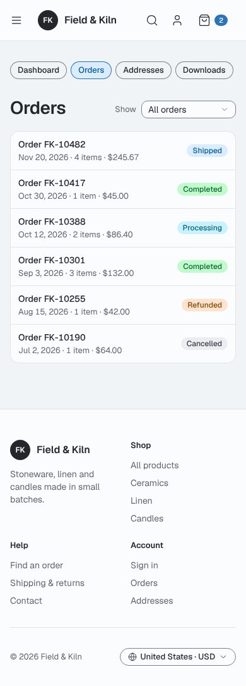
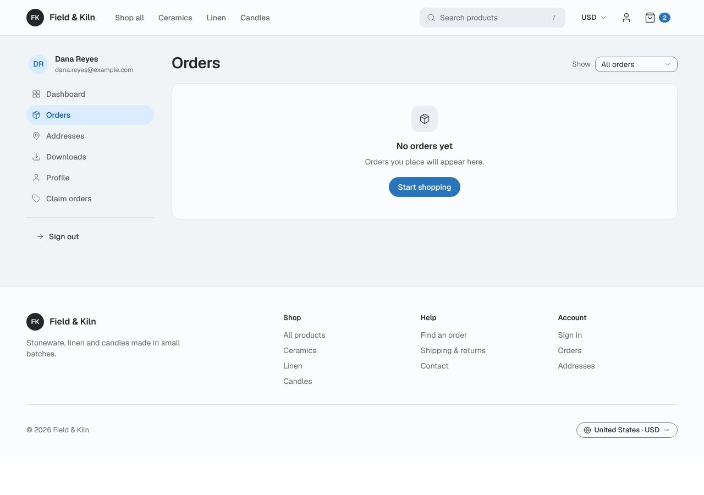
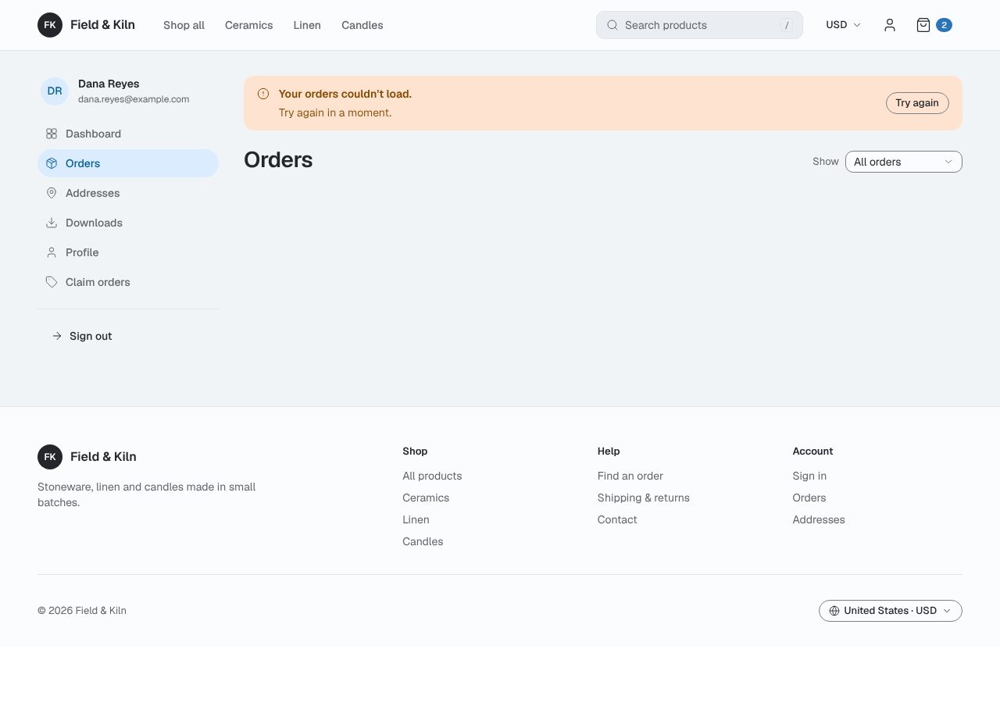

## Design

Order history.

**Desktop, light**

**Desktop, dark**

**Mobile, light**

**Empty**

**Could not load**

### Spec

**Design system components:** Table, Badge, Select, Pagination, List (mobile)

- Table on desktop, list on mobile; "Show" filter.
- Every page board on the canvas also has dark, high-contrast and right-to-left versions at desktop and mobile.

**States:** Empty, Could not load.

**Tokens only:** every color, radius and size comes from `--apui-*` tokens and the component bundle; no DaisyUI classes.

Canvas boards: [Account-orders](https://claude.ai/code/artifact/1433c967-7beb-45a4-8e05-e2785d8f8e57#artboard-Account-orders), [Account-orders-empty](https://claude.ai/code/artifact/1433c967-7beb-45a4-8e05-e2785d8f8e57#artboard-Account-orders-empty), [Account-orders-error](https://claude.ai/code/artifact/1433c967-7beb-45a4-8e05-e2785d8f8e57#artboard-Account-orders-error) (part of the design for #60).
