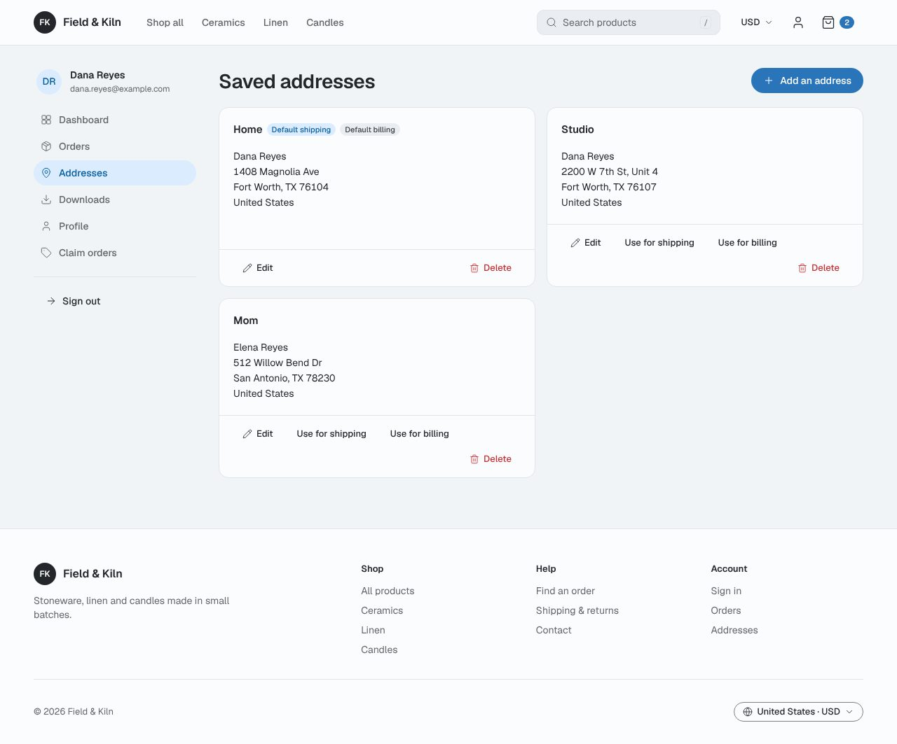
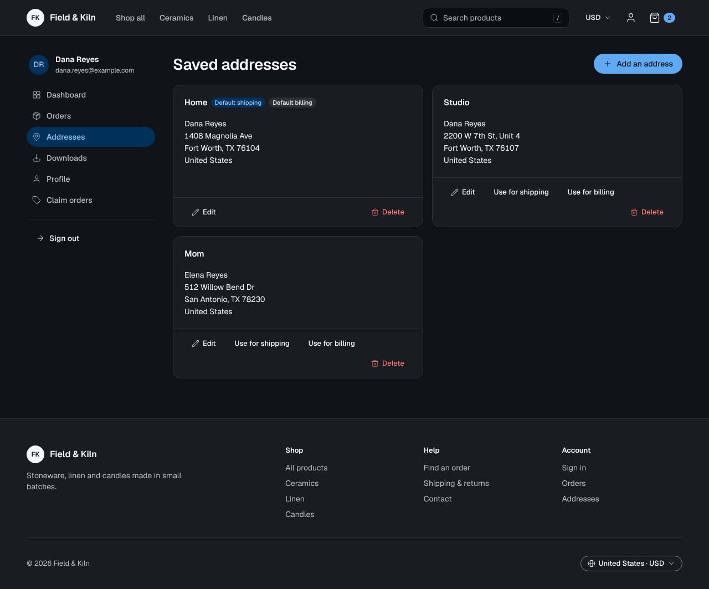
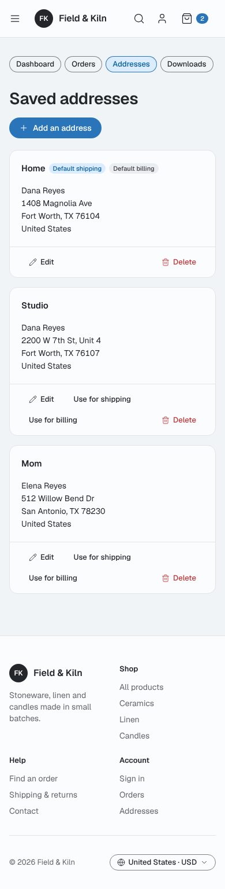
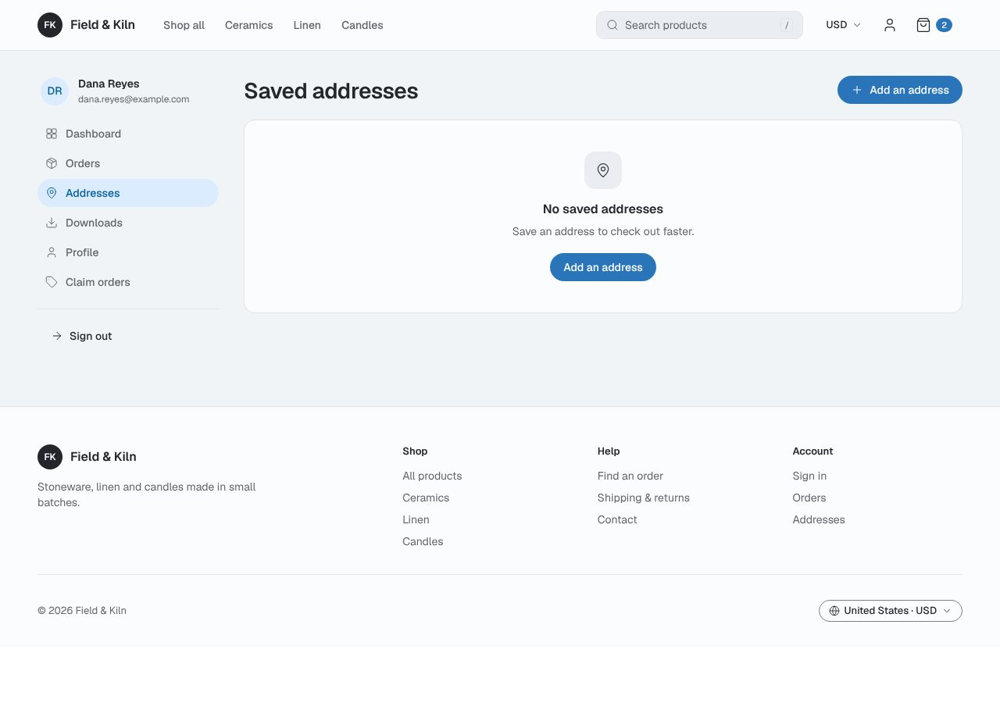
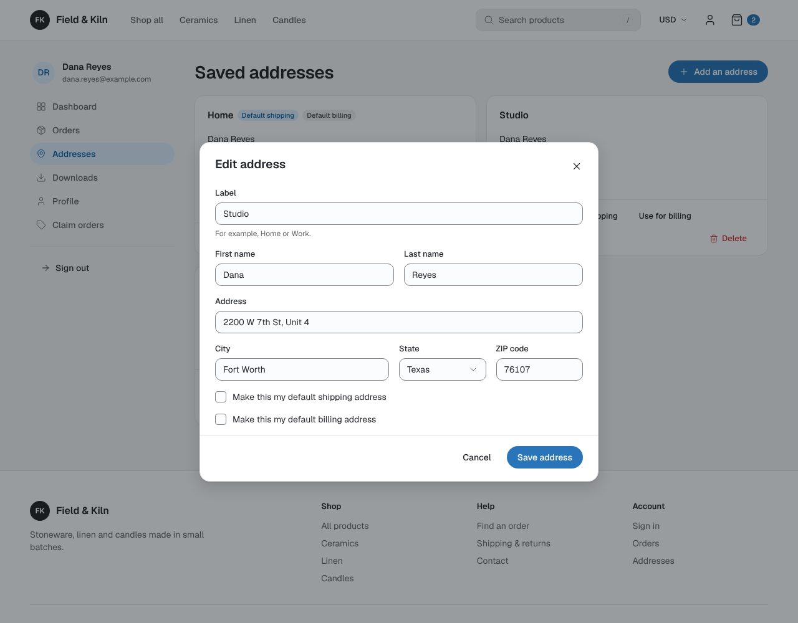
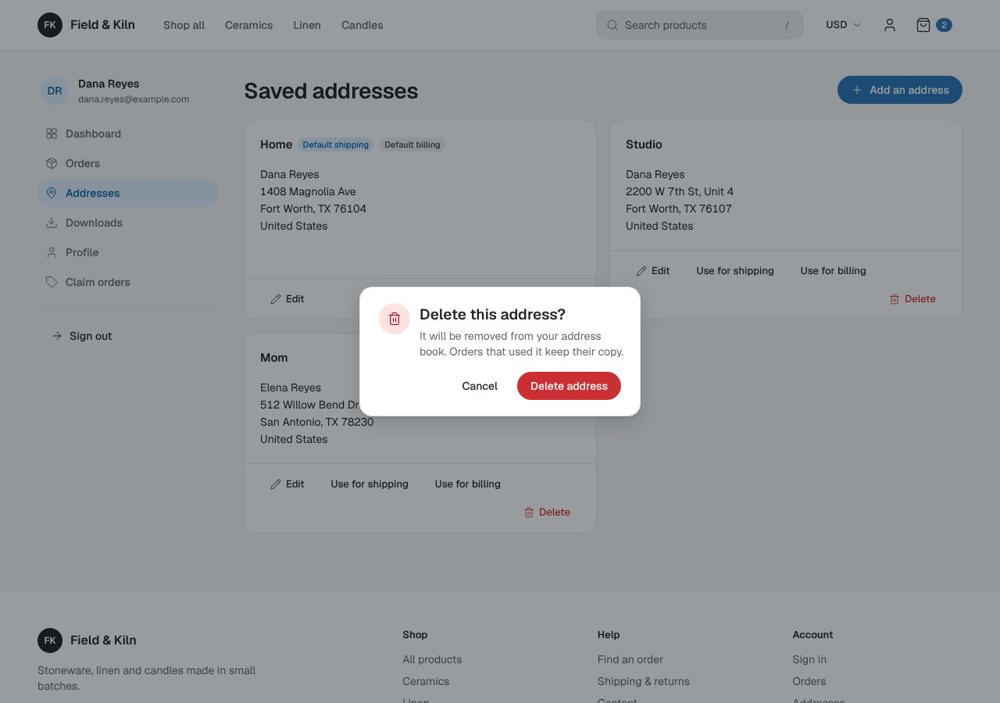

## Design

Address book.

**Desktop, light**

**Desktop, dark**

**Mobile, light**

**Empty**

**Edit**

**Delete**

### Spec

**Design system components:** Card, Badge, Button, Dialog, Address form

- Cards with default badges, Edit, Use for shipping/billing, Delete.
- Every page board on the canvas also has dark, high-contrast and right-to-left versions at desktop and mobile.

**States:** Empty, Edit dialog, Delete confirmation.

**Tokens only:** every color, radius and size comes from `--apui-*` tokens and the component bundle; no DaisyUI classes.

Canvas boards: [Account-addresses](https://claude.ai/code/artifact/1433c967-7beb-45a4-8e05-e2785d8f8e57#artboard-Account-addresses) (part of the design for #60).
