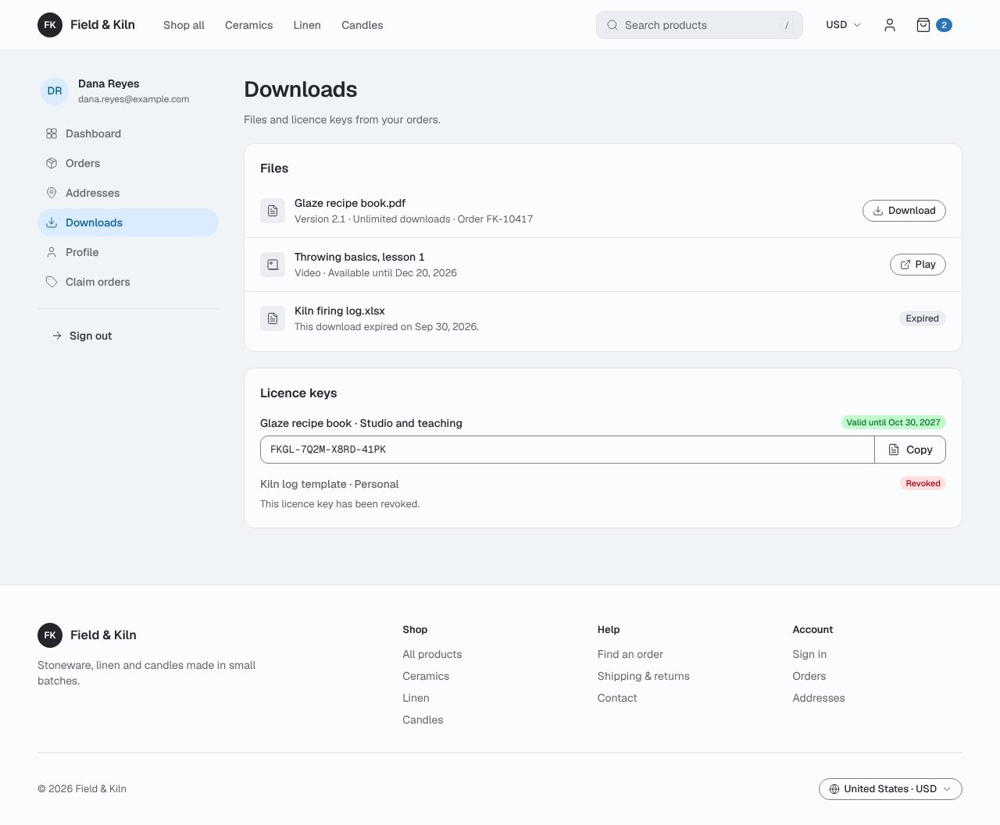
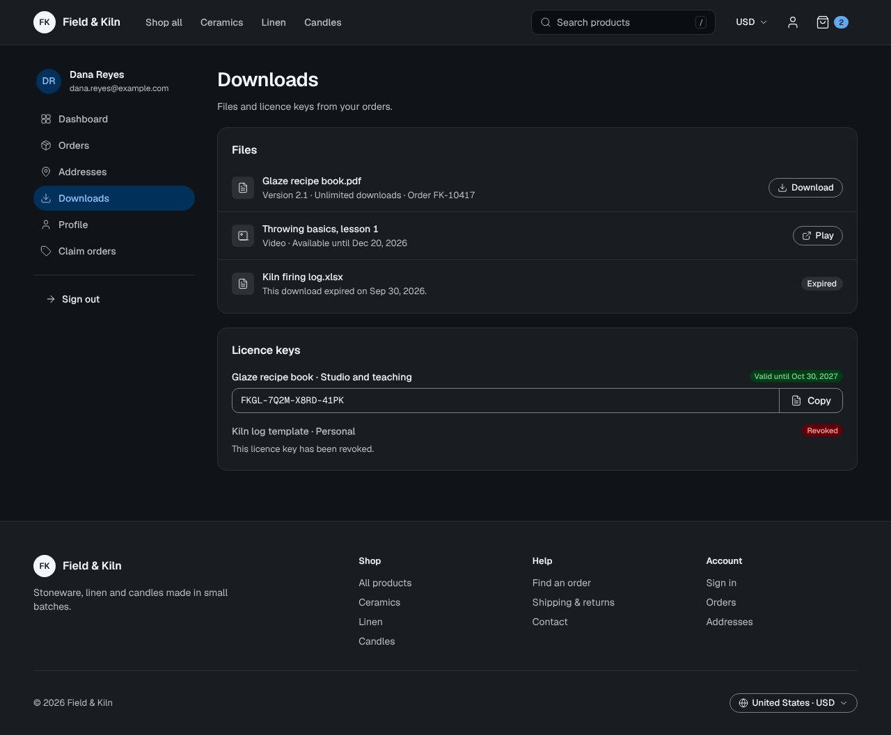
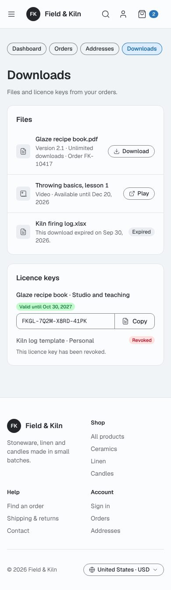
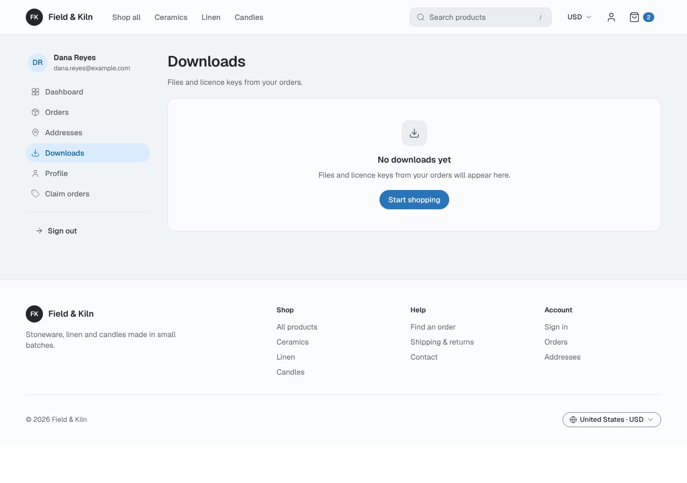

## Design

Downloads.

**Desktop, light**

**Desktop, dark**

**Mobile, light**

**Empty**

### Spec

**Design system components:** Card, List, Badge, Button, Clipboard

- Files (download, play, expired) and licence keys (copy, valid, revoked).
- Every page board on the canvas also has dark, high-contrast and right-to-left versions at desktop and mobile.

**States:** Empty.

**Tokens only:** every color, radius and size comes from `--apui-*` tokens and the component bundle; no DaisyUI classes.

Canvas boards: [Account-downloads](https://claude.ai/code/artifact/1433c967-7beb-45a4-8e05-e2785d8f8e57#artboard-Account-downloads) (part of the design for #60).
