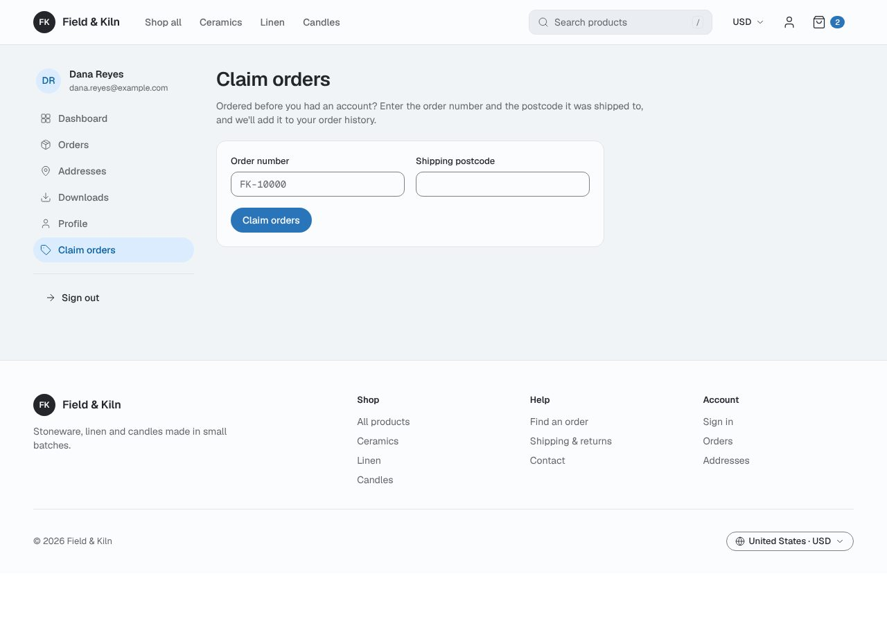
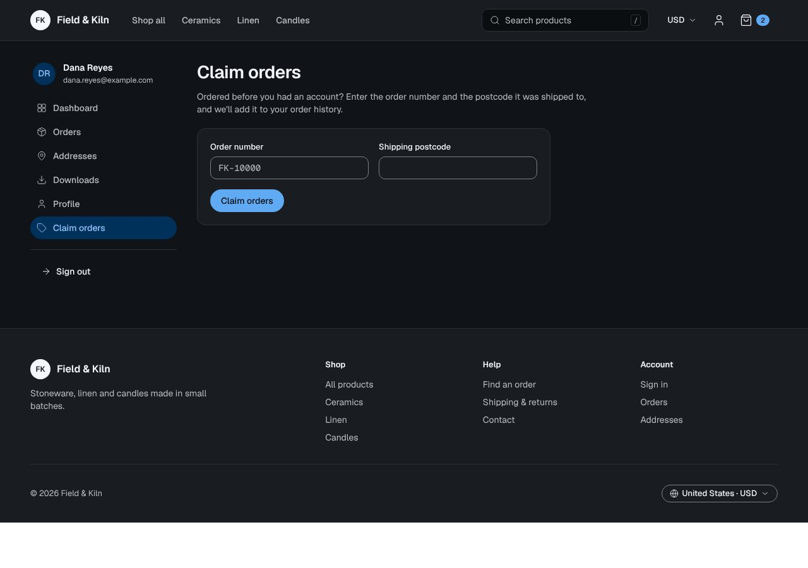
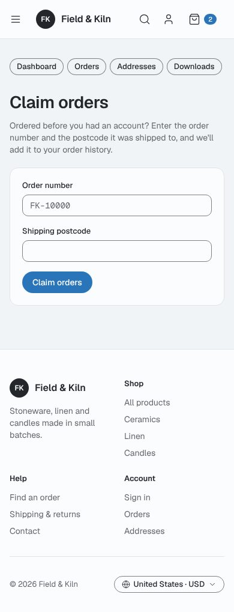
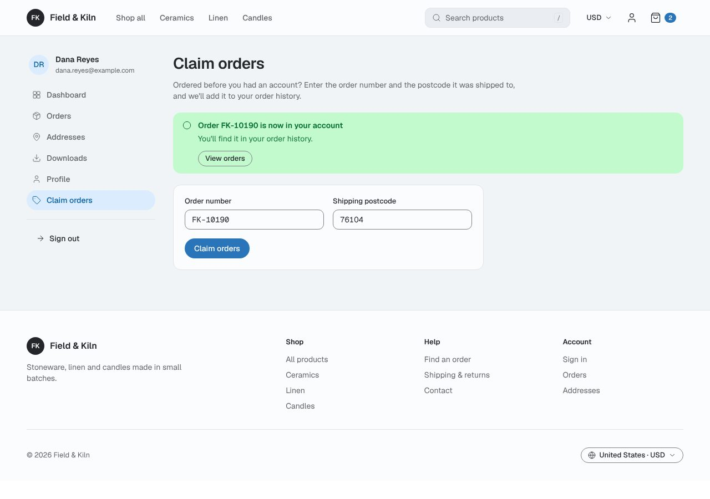

## Design

Claim guest orders.

**Desktop, light**

**Desktop, dark**

**Mobile, light**

**Success**

### Spec

**Design system components:** Card, Field, Input, Button, Alert

- Order number + shipping postcode; success alert links to orders.
- Every page board on the canvas also has dark, high-contrast and right-to-left versions at desktop and mobile.

**States:** Success.

**Tokens only:** every color, radius and size comes from `--apui-*` tokens and the component bundle; no DaisyUI classes.

Canvas boards: [Account-claim](https://claude.ai/code/artifact/1433c967-7beb-45a4-8e05-e2785d8f8e57#artboard-Account-claim) (part of the design for #60).
