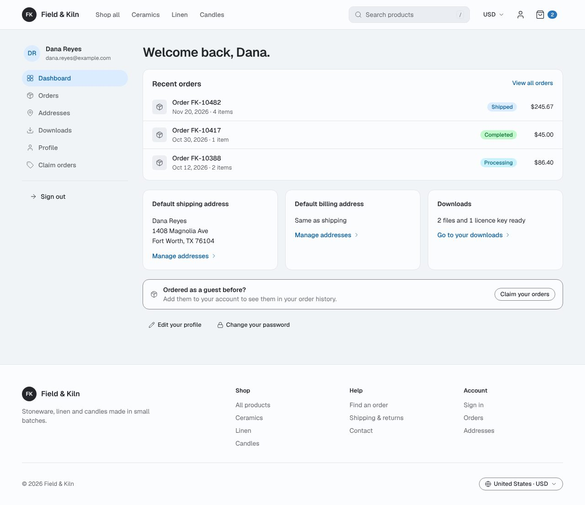
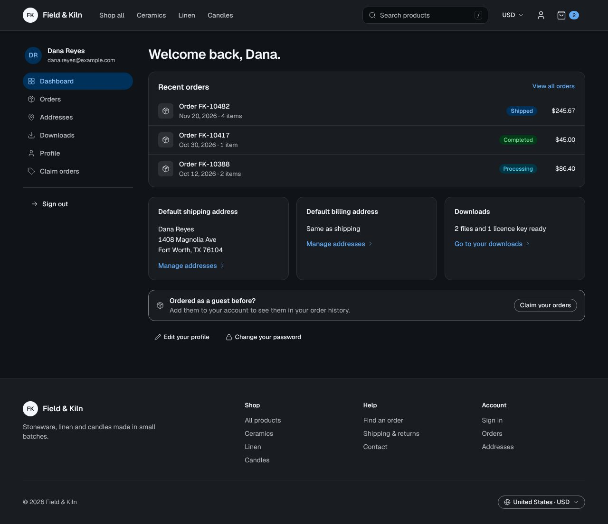
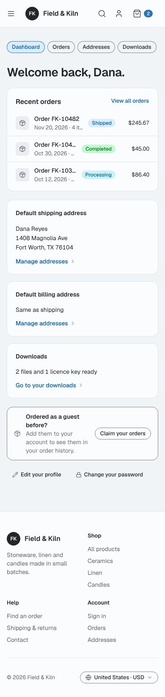

## Design

The account area layout: a sidebar on desktop and a scrolling row of tabs below 1024px.

**Desktop, light**

**Desktop, dark**

**Mobile, light**

### Spec

**Design system components:** AppShell parts (`nav` items in a Menu), Avatar, Divider, Button (ghost), Chip (selectable) for the mobile tabs

- Two-column grid, 232px sidebar plus content, 32px gap; the sidebar hides below 1024px and the chip row takes over.
- Sidebar: Avatar (`data-color="primary"`) with name and email, then nav items with icons; the current one carries `aria-current="page"` and gets `--apui-selected-bg`.
- Sign out is a ghost neutral Button below a Divider.
- Page content starts with a PageHeader (`heading-xl`).

**Accessibility**

- Both navs are `<nav aria-label="Account">`; only one shows at a time.
- The tab row scrolls horizontally and never wraps the page.

**Tokens only:** every color, radius and size comes from `--apui-*` tokens and the component bundle; no DaisyUI classes.

Canvas boards: [Account](https://claude.ai/code/artifact/1433c967-7beb-45a4-8e05-e2785d8f8e57#artboard-Account), [Account-mobile](https://claude.ai/code/artifact/1433c967-7beb-45a4-8e05-e2785d8f8e57#artboard-Account-mobile) (part of the design for #60).
