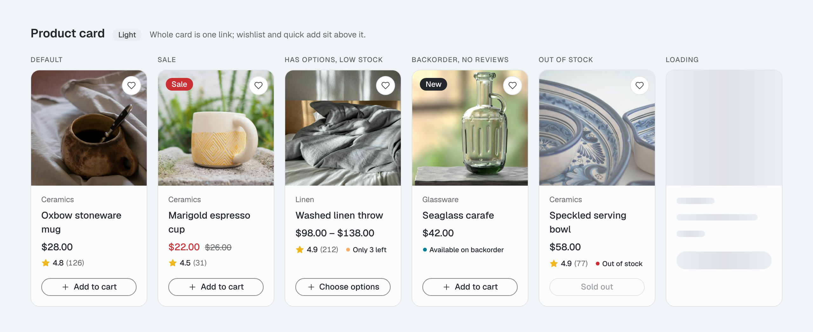
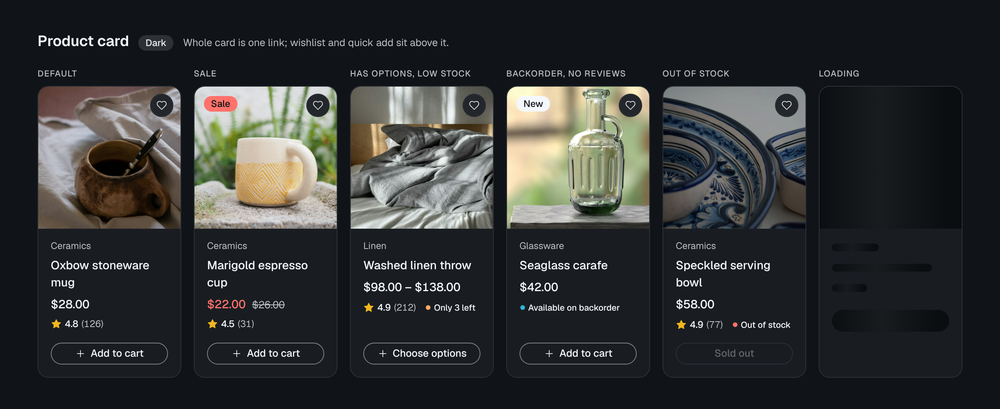

## Design

One card for every product listing: image, category, name, price, rating, stock and an optional quick add.

**Light**

**Dark**

### Spec

**Design system components:** Card, Badge (solid for New/Sale/Bundle, ghost with dot for stock), Button (outline neutral sm; solid neutral icon-only for wishlist), Icon

- Square image on `--apui-surface-sunken`; overlay badge top-start, wishlist button top-end.
- Body padding 14/16px: category (`caption`, muted) → name (15/22, weight 500) → price → rating and stock row → quick add pinned to the bottom.
- The name link stretches over the whole card (`::after`), so there is one link per product; wishlist and quick add sit above it (`z-index: 1`).
- Hover raises the edge to `--apui-border-strong`; `:focus-within` draws the focus ring around the card.
- Variable products say "Choose options"; out of stock shows a disabled "Sold out" and dims the image to 60%.

**States:** Default, Sale (was price struck through), Has options, Low stock, Backorder, Out of stock, No reviews (rating hidden), Loading skeleton.

**Accessibility**

- Quick add button text includes the product name for screen readers ("Add to cart: Oxbow stoneware mug").
- Rating has a visually hidden sentence ("Rated 4.8 out of 5 from 126 reviews").

**Tokens only:** every color, radius and size comes from `--apui-*` tokens and the component bundle; no DaisyUI classes.

Canvas boards: [CardStates](https://claude.ai/code/artifact/1433c967-7beb-45a4-8e05-e2785d8f8e57#artboard-CardStates), [ProductCard](https://claude.ai/code/artifact/1433c967-7beb-45a4-8e05-e2785d8f8e57#artboard-ProductCard) (part of the design for #60).
