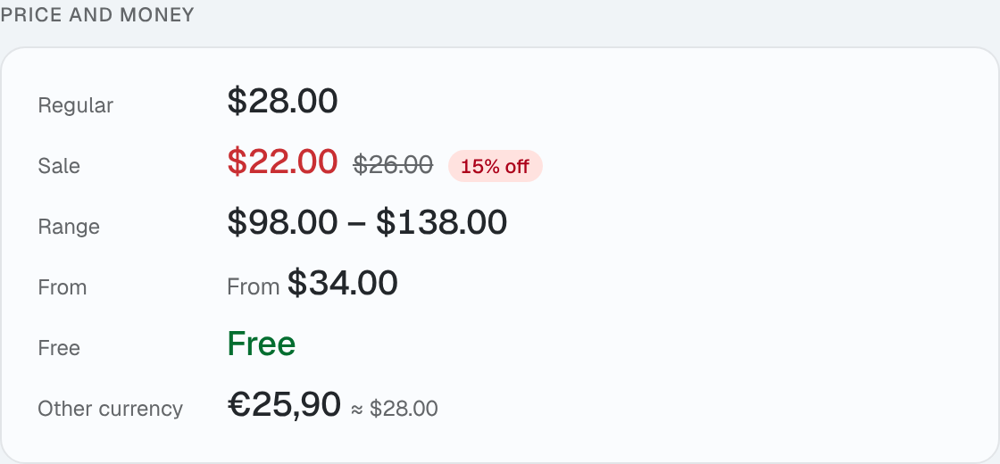
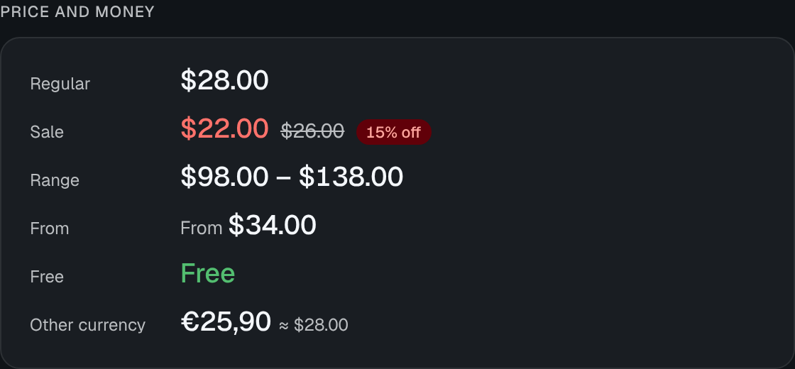

## Design

How prices read everywhere: regular, sale, range, "From" and free.

**Light**

**Dark**

### Spec

**Design system components:** Text styles only, plus Badge (soft error) for the optional percentage

- Weight 500 with `tabular-nums`; sizes follow context (15px on cards, 23px on the product page).
- Sale: price in `--apui-color-error-text`, original price muted with a strike-through.
- Ranges use an en dash with spaces ("$98.00 – $138.00"). "From" is muted 13px before the amount.
- Free uses `--apui-color-success-text` and the word "Free", never "$0.00".

**Accessibility**

- Sale and original prices carry visually hidden labels ("Sale price", "Original price"); color is never the only signal.

**Tokens only:** every color, radius and size comes from `--apui-*` tokens and the component bundle; no DaisyUI classes.

Canvas boards: [Commerce](https://claude.ai/code/artifact/1433c967-7beb-45a4-8e05-e2785d8f8e57#artboard-Commerce) (part of the design for #60).
