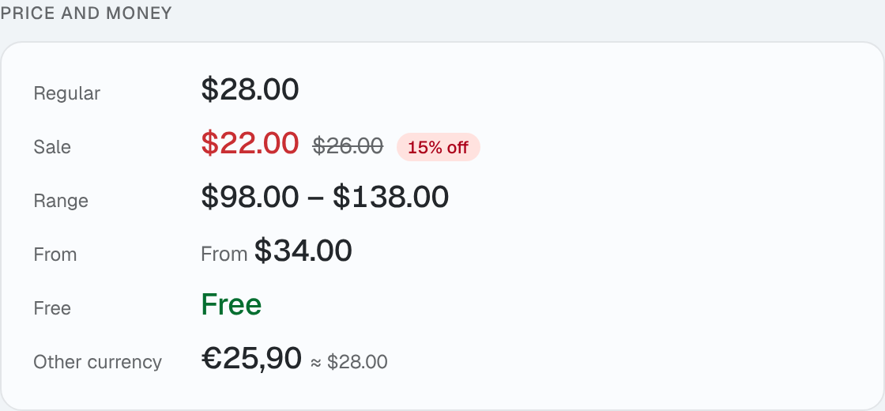
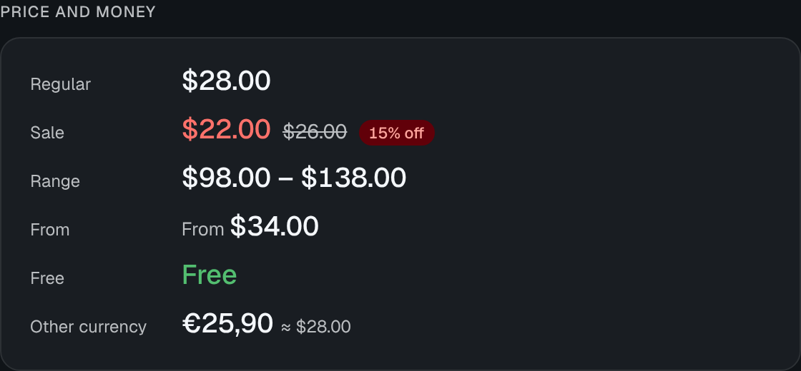

## Design

Money formatting: locale-aware amounts, with the store currency shown alongside when the shopper picks another.

**Light**

**Dark**

### Spec

**Design system components:** Text styles only

- Always `tabular-nums` so columns of money line up; table cells align to the inline end.
- A converted amount shows the store-currency equivalent after it in `caption` muted ("€25,90 ≈ $28.00").
- Negative amounts (discounts) use a true minus sign "−" plus a visually hidden "Minus".

**Tokens only:** every color, radius and size comes from `--apui-*` tokens and the component bundle; no DaisyUI classes.

Canvas boards: [Commerce](https://claude.ai/code/artifact/1433c967-7beb-45a4-8e05-e2785d8f8e57#artboard-Commerce) (part of the design for #60).
