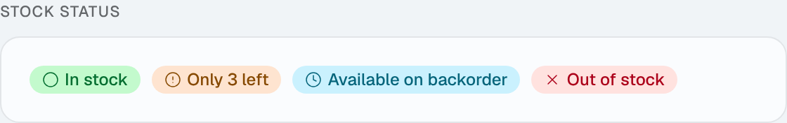
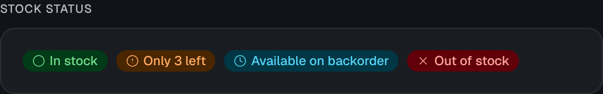

## Design

Stock status as a soft badge with an icon and a label.

**Light**

**Dark**

### Spec

**Design system components:** Badge (soft; ghost with dot on product cards), Icon

- In stock: success + check-circle. Low stock: warning + alert ("Only 3 left"). Backorder: info + clock. Out of stock: error + x.
- Product cards use the compact ghost badge with a dot and hide the "In stock" case.

**Accessibility**

- The label always carries the meaning; the color and icon only reinforce it.

**Tokens only:** every color, radius and size comes from `--apui-*` tokens and the component bundle; no DaisyUI classes.

Canvas boards: [Commerce](https://claude.ai/code/artifact/1433c967-7beb-45a4-8e05-e2785d8f8e57#artboard-Commerce) (part of the design for #60).
