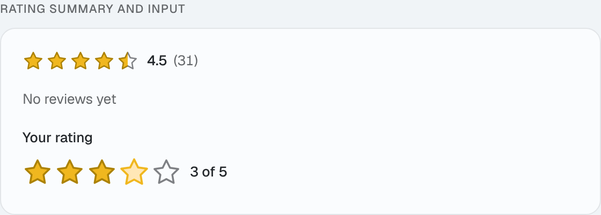
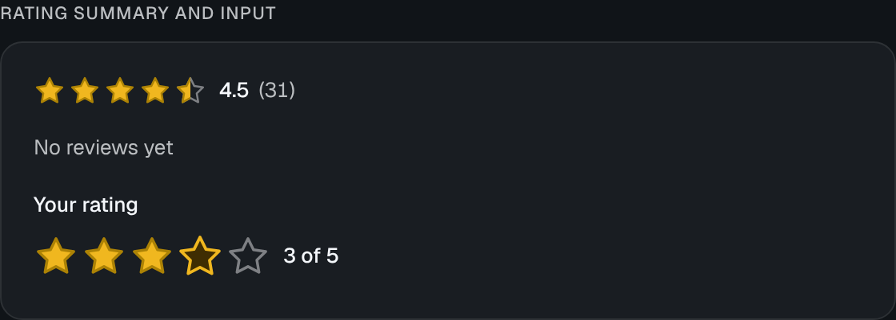

## Design

Rating summary: stars, the average and the review count, linking to the reviews.

**Light**

**Dark**

### Spec

**Design system components:** Rating (display), Icon

- Stars use `--apui-color-accent` filled with the accent border, unfilled use `--apui-border-default`; half stars use the `half` part.
- Average in `label-sm` default text, count muted; on cards a compact form shows one star plus "4.8 (126)".
- When there are no reviews, show "No reviews yet" (muted) or hide it on cards (`hide-empty`).

**Accessibility**

- The whole summary is one link with `aria-label="Rated 4.5 out of 5, 31 reviews"`.

**Tokens only:** every color, radius and size comes from `--apui-*` tokens and the component bundle; no DaisyUI classes.

Canvas boards: [Commerce](https://claude.ai/code/artifact/1433c967-7beb-45a4-8e05-e2785d8f8e57#artboard-Commerce) (part of the design for #60).
