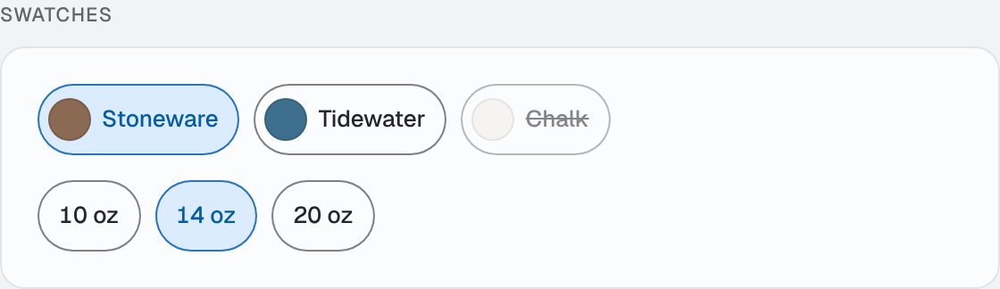
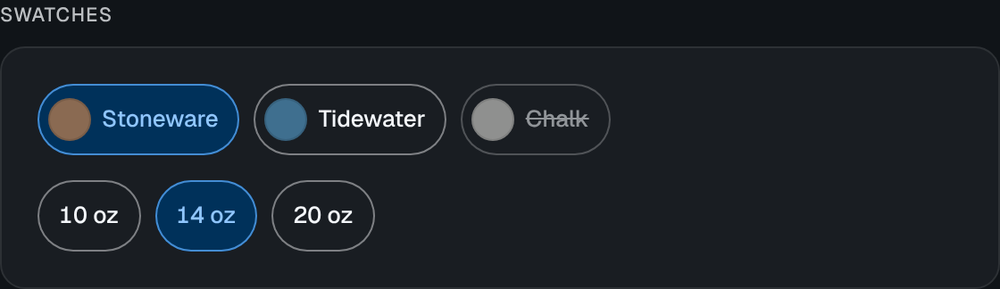

## Design

Swatches for attributes, as color chips or text chips.

**Light**

**Dark**

### Spec

**Design system components:** Chip (`data-selectable`), ColorPicker swatch part

- 40px tall chips with a 24px round color dot and the value name; selected uses `aria-pressed="true"` (selected background and border).
- Text-only swatches (sizes) are the same chip without the dot, min-width 56px, centered.
- Unavailable values stay visible at 55% opacity with a strike-through and a hidden "(sold out)".
- In catalog filters, multiple selection is allowed; on the product page it acts as a radio group.

**Accessibility**

- The fieldset legend shows the chosen value ("Glaze: Stoneware").

**Tokens only:** every color, radius and size comes from `--apui-*` tokens and the component bundle; no DaisyUI classes.

Canvas boards: [Commerce](https://claude.ai/code/artifact/1433c967-7beb-45a4-8e05-e2785d8f8e57#artboard-Commerce), [Filters](https://claude.ai/code/artifact/1433c967-7beb-45a4-8e05-e2785d8f8e57#artboard-Filters) (part of the design for #60).
