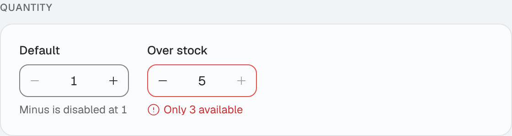
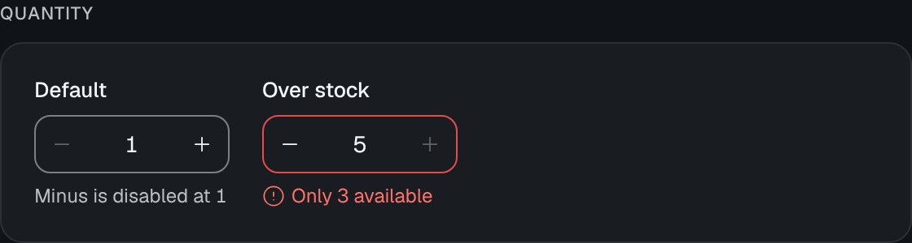

## Design

Quantity stepper: minus, number, plus inside one input.

**Light**

**Dark**

### Spec

**Design system components:** Input (with ghost icon-only Buttons inside), Field error

- Sizes: lg on the product page (132px wide), sm in the cart, xs buttons in the drawer.
- Minus is `aria-disabled` at the minimum; plus is `aria-disabled` at the stock limit.
- Over stock shows a field error: "Only 3 available".

**Accessibility**

- Buttons are labelled "Decrease quantity, {name}" / "Increase quantity, {name}"; the input has its own label.

**Tokens only:** every color, radius and size comes from `--apui-*` tokens and the component bundle; no DaisyUI classes.

Canvas boards: [Commerce](https://claude.ai/code/artifact/1433c967-7beb-45a4-8e05-e2785d8f8e57#artboard-Commerce) (part of the design for #60).
