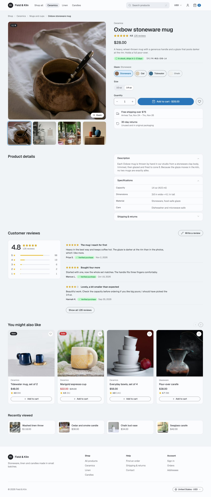
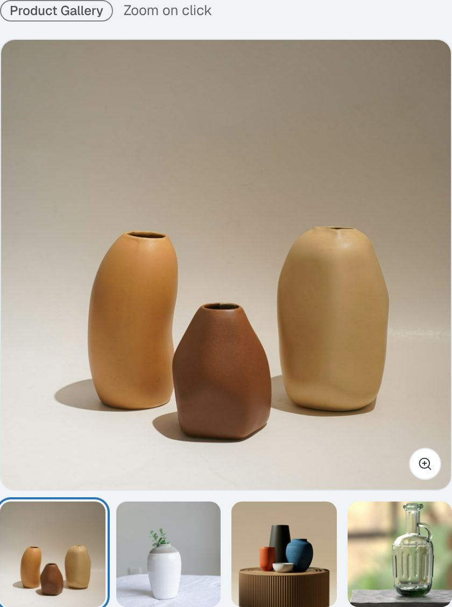

## Design

Product gallery: a large image with zoom and a row of thumbnails.

**Product page**

**Gallery block**

### Spec

**Design system components:** Button (solid neutral, raised surface) for zoom, Badge for the "1 / 4" counter

- Main image is square, `--apui-radius-lg`, hairline border; thumbnails are a 4-column grid, `--apui-radius-md`.
- The current thumbnail gets a 2px primary ring with a 2px page-colored gap.
- Zoom opens the design system Lightbox.

**Accessibility**

- Thumbnails are buttons labelled "Image 2 of 4: …" with `aria-current` on the active one.

**Tokens only:** every color, radius and size comes from `--apui-*` tokens and the component bundle; no DaisyUI classes.

Canvas boards: [Product](https://claude.ai/code/artifact/1433c967-7beb-45a4-8e05-e2785d8f8e57#artboard-Product), [BlocksProduct](https://claude.ai/code/artifact/1433c967-7beb-45a4-8e05-e2785d8f8e57#artboard-BlocksProduct) (part of the design for #60).
