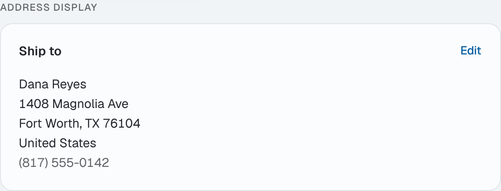
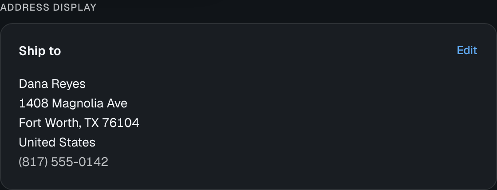

## Design

Address display: a plain `<address>` in a card with an optional Edit action.

**Light**

**Dark**

### Spec

**Design system components:** Card (header, actions, body), Button (link)

- Name, street lines, city/region/postcode, country, then phone muted; 22px line height.
- Used in checkout summaries, order details, the address book and the dashboard.

**Tokens only:** every color, radius and size comes from `--apui-*` tokens and the component bundle; no DaisyUI classes.

Canvas boards: [FormsSheet](https://claude.ai/code/artifact/1433c967-7beb-45a4-8e05-e2785d8f8e57#artboard-FormsSheet) (part of the design for #60).
