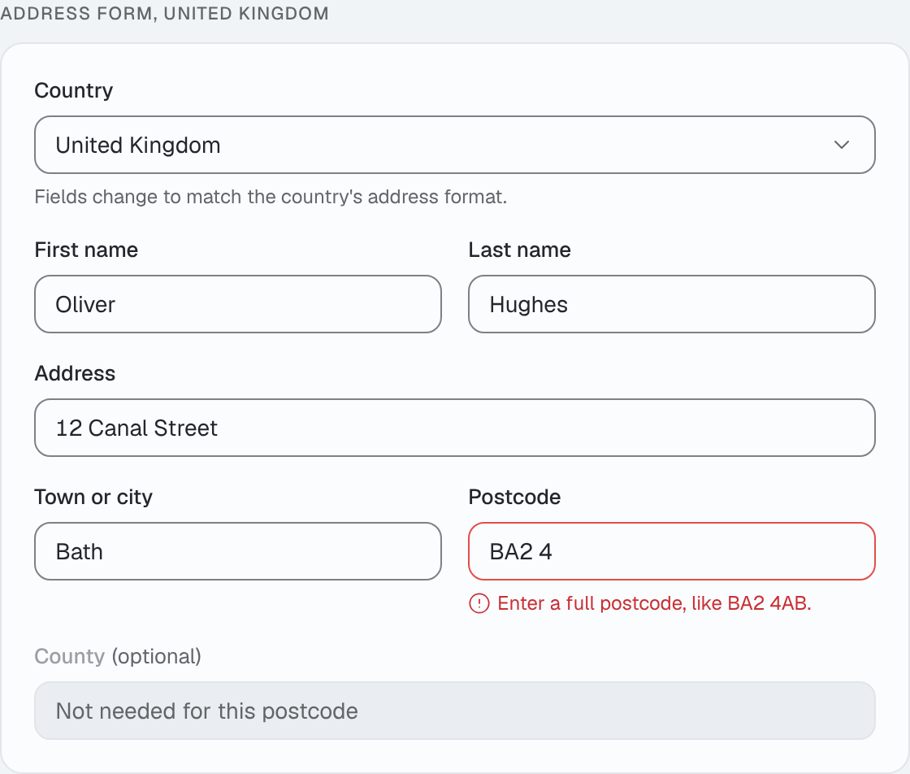
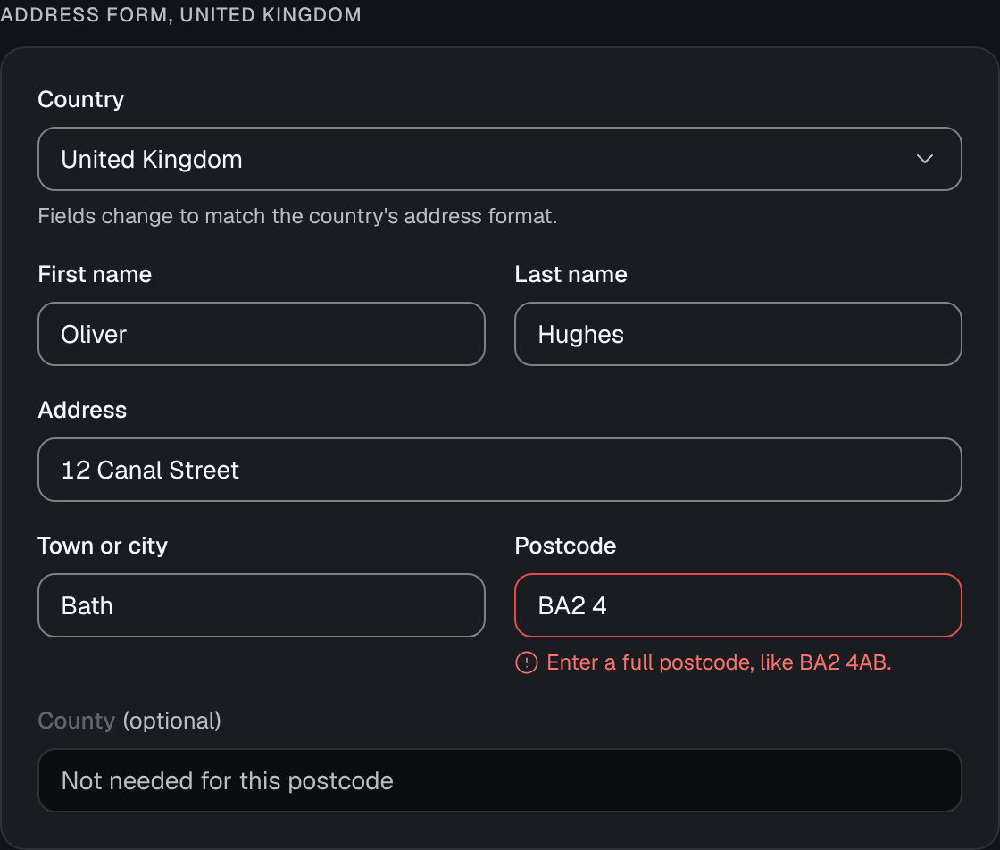
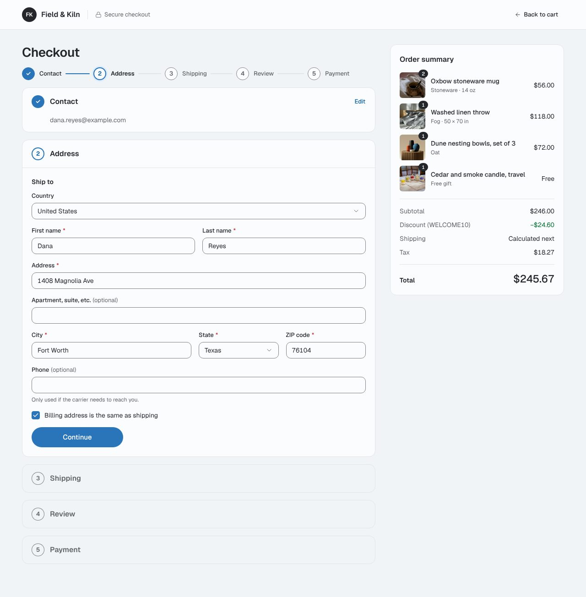

## Design

Address form: fields that follow the country's address format.

**Light**

**Dark**

**In checkout**

### Spec

**Design system components:** Field, Input, Select, Checkbox

- Country first; labels, required fields and the postcode format change with it (ZIP code vs Postcode, State vs County).
- Rows: first/last name 2-up; address; apartment (optional); city / state / postcode 3-up (2fr 1fr 1fr); phone (optional).
- Everything stacks to one column below 768px.
- Optional fields say "(optional)" in muted text; required fields have a red asterisk hidden from screen readers.

**Accessibility**

- Every input has `autocomplete` (given-name, address-line1, postal-code, …).
- Errors sit under the field and are linked with `aria-describedby`.

**Tokens only:** every color, radius and size comes from `--apui-*` tokens and the component bundle; no DaisyUI classes.

Canvas boards: [FormsSheet](https://claude.ai/code/artifact/1433c967-7beb-45a4-8e05-e2785d8f8e57#artboard-FormsSheet), [Checkout-address](https://claude.ai/code/artifact/1433c967-7beb-45a4-8e05-e2785d8f8e57#artboard-Checkout-address) (part of the design for #60).
