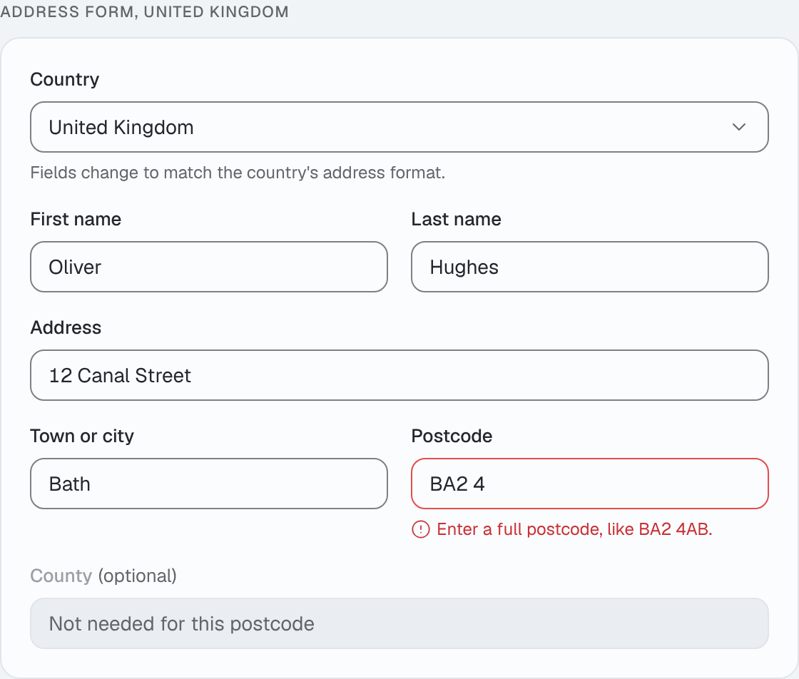
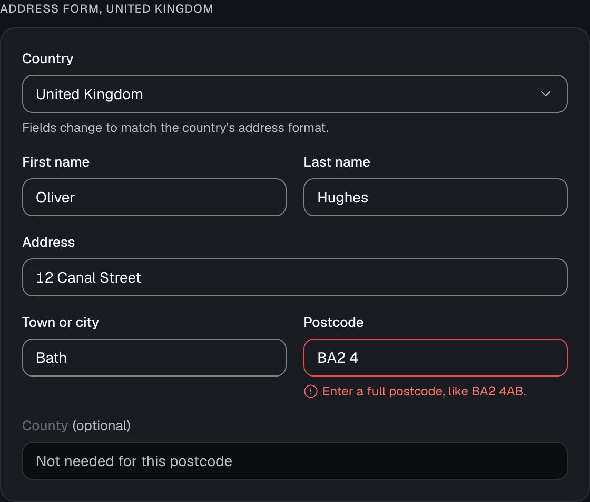

## Design

The storefront field wrapper: label, control, hint and error.

**Light**

**Dark**

### Spec

**Design system components:** Field (label, optional, required, hint, error parts), Input

- Label `label-sm`; hint and error `caption`; error in `--apui-color-error-text` with an alert icon.
- Invalid fields set `data-invalid` on the Field so the control edge turns `--apui-color-error-border`.
- Disabled uses the Field `data-disabled` state.

**Accessibility**

- `aria-invalid` and `aria-describedby` point at the error text.

**Tokens only:** every color, radius and size comes from `--apui-*` tokens and the component bundle; no DaisyUI classes.

Canvas boards: [FormsSheet](https://claude.ai/code/artifact/1433c967-7beb-45a4-8e05-e2785d8f8e57#artboard-FormsSheet) (part of the design for #60).
