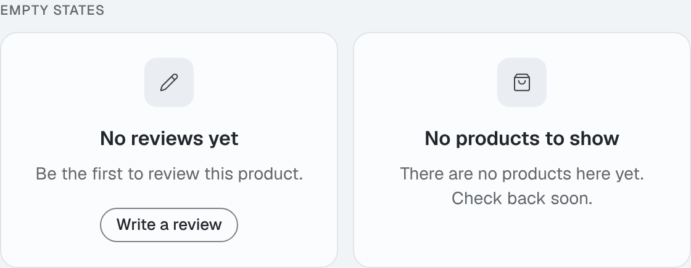
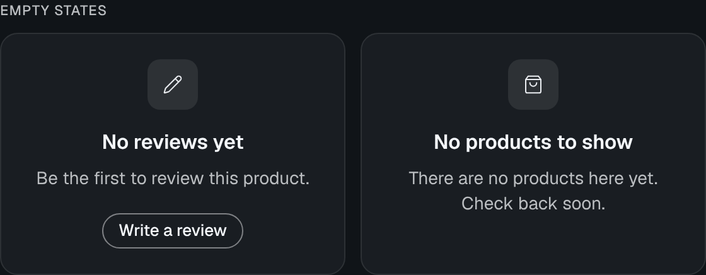
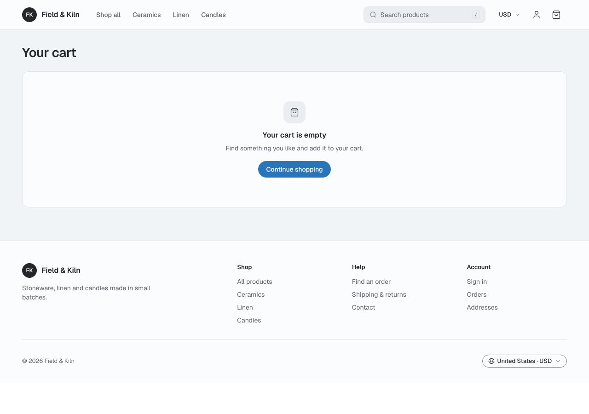

## Design

Empty states: an icon tile, a title, one line of help and at most two actions.

**Light**

**Dark**

**Empty cart**

### Spec

**Design system components:** EmptyState, Icon tile, Button

- Inside a Card when it replaces a list; `data-size="sm"` inside other cards.
- One solid primary action when there is a clear next step (Start shopping, Clear filters), otherwise outline neutral.

**Tokens only:** every color, radius and size comes from `--apui-*` tokens and the component bundle; no DaisyUI classes.

Canvas boards: [FeedbackSheet](https://claude.ai/code/artifact/1433c967-7beb-45a4-8e05-e2785d8f8e57#artboard-FeedbackSheet), [Cart-empty](https://claude.ai/code/artifact/1433c967-7beb-45a4-8e05-e2785d8f8e57#artboard-Cart-empty) (part of the design for #60).
