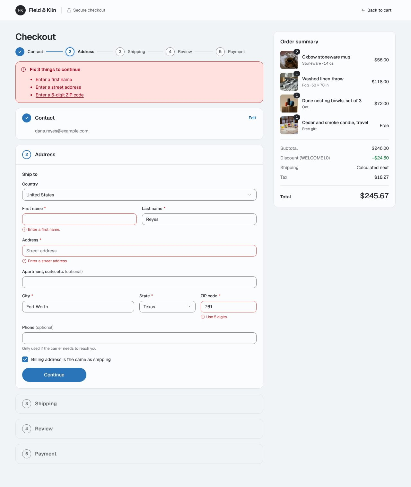

## Design

Form error summary at the top of a form that failed validation.

**Checkout with errors**

### Spec

**Design system components:** ValidationSummary

- Title says how many things to fix ("Fix 3 things to continue"); each item links to its field.
- Fields keep their own inline errors too.

**Accessibility**

- `role="alert"` and focus moves to the summary after a failed submit (`tabindex="-1"`).

**Tokens only:** every color, radius and size comes from `--apui-*` tokens and the component bundle; no DaisyUI classes.

Canvas boards: [Checkout-errors](https://claude.ai/code/artifact/1433c967-7beb-45a4-8e05-e2785d8f8e57#artboard-Checkout-errors) (part of the design for #60).
