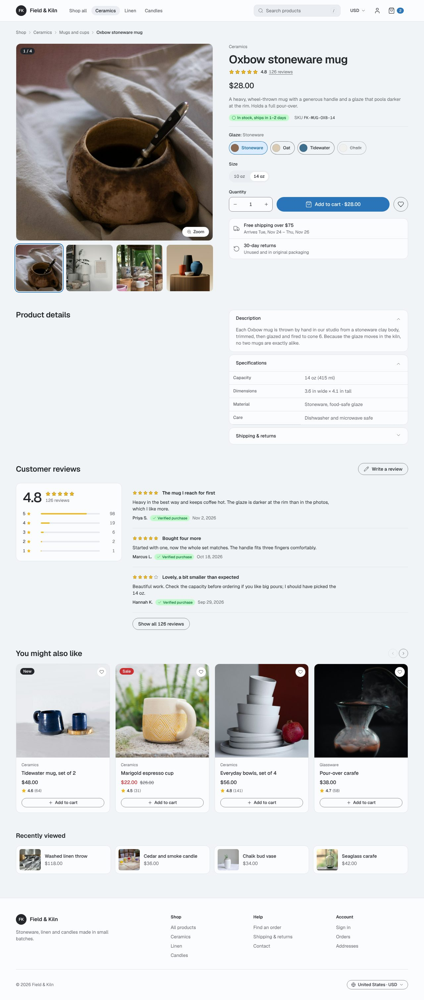
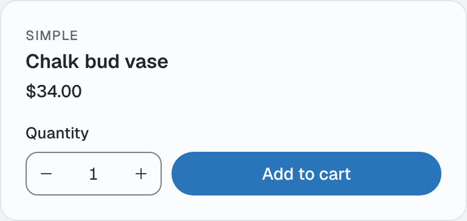

## Design

The add-to-cart row shared by every purchase form: quantity, the primary button and wishlist.

**Product page**

**Simple form**

### Spec

**Design system components:** Input stepper, Button (solid lg, outline neutral icon-only)

- Quantity (132px) + Add to cart (flex: 1, min 200px, shows the line price) + wishlist; wraps on narrow screens.
- Add to cart is the only solid primary on the product page.

**States:** Default, Out of stock: replaced by a "Notify me" alert with an email field.

**Tokens only:** every color, radius and size comes from `--apui-*` tokens and the component bundle; no DaisyUI classes.

Canvas boards: [Product](https://claude.ai/code/artifact/1433c967-7beb-45a4-8e05-e2785d8f8e57#artboard-Product), [Product-oos](https://claude.ai/code/artifact/1433c967-7beb-45a4-8e05-e2785d8f8e57#artboard-Product-oos), [PurchaseForms](https://claude.ai/code/artifact/1433c967-7beb-45a4-8e05-e2785d8f8e57#artboard-PurchaseForms) (part of the design for #60).
