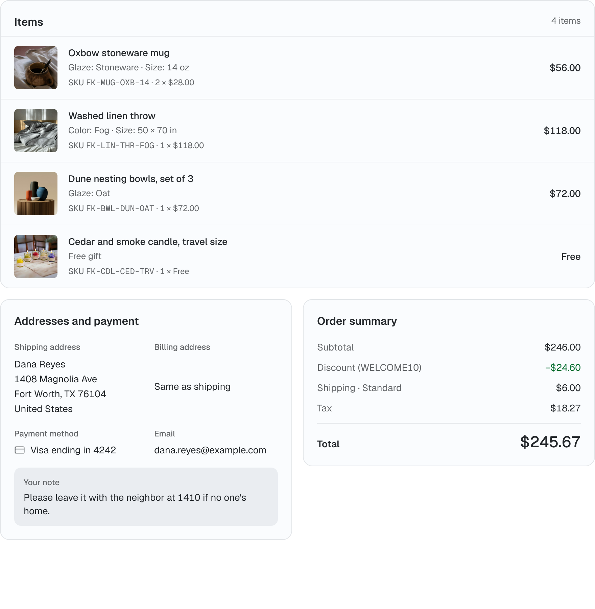

## Design

Order details: items, addresses and payment, and the order summary.

**Order details**

### Spec

**Design system components:** Card, List rows, `<dl>` meta, Divider

- Items card: 64px thumbnail, name, options, SKU in Geist Mono, "2 × $28.00", line total.
- Below, two cards side by side (stacking on mobile): Addresses and payment (`<dl>` grid with shipping, billing, payment method, email, and the shopper's note on a sunken panel), and Order summary.
- Shared by the order confirmation, the guest order view and the account order page.

**Tokens only:** every color, radius and size comes from `--apui-*` tokens and the component bundle; no DaisyUI classes.

Canvas boards: [OrderDetails](https://claude.ai/code/artifact/1433c967-7beb-45a4-8e05-e2785d8f8e57#artboard-OrderDetails), [Order](https://claude.ai/code/artifact/1433c967-7beb-45a4-8e05-e2785d8f8e57#artboard-Order), [Account-order](https://claude.ai/code/artifact/1433c967-7beb-45a4-8e05-e2785d8f8e57#artboard-Account-order) (part of the design for #60).
