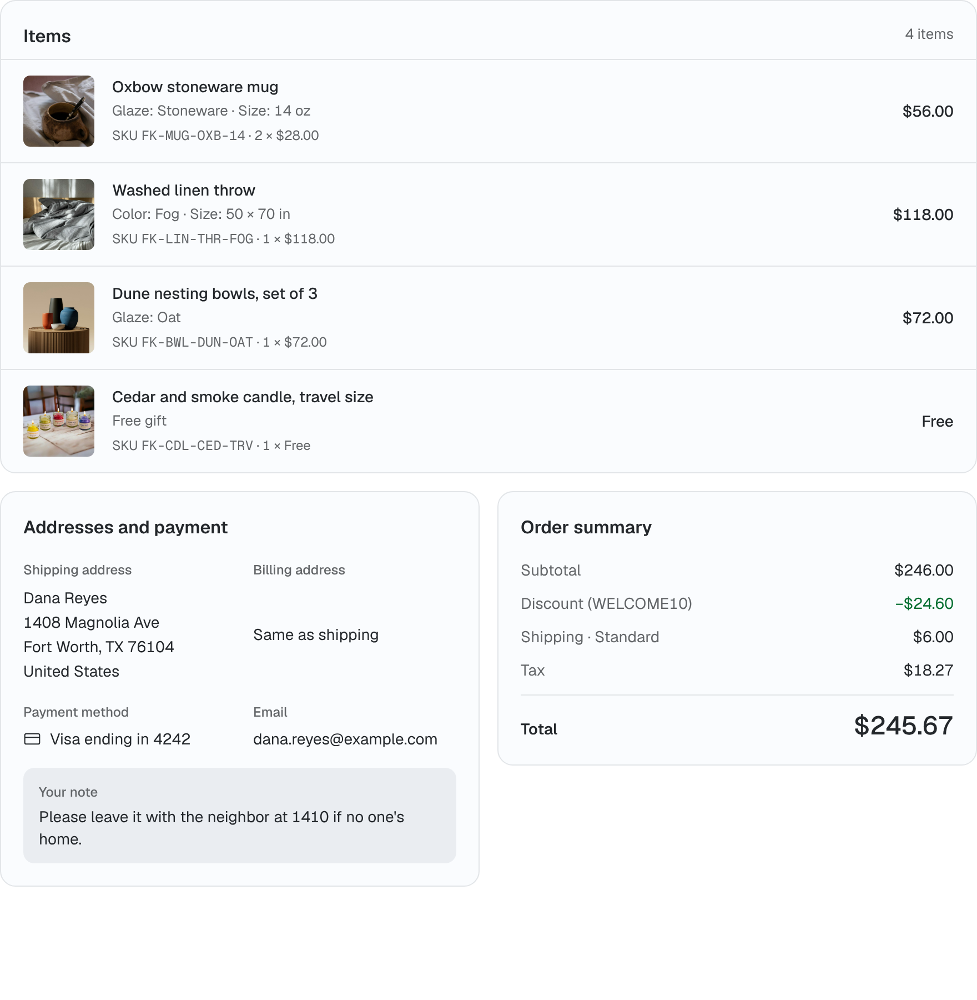

## Design

Order totals: subtotal, discounts, shipping, tax and a large total.

**Order summary**

### Spec

**Design system components:** Meta list (`apui-meta`), Divider

- Rows in `body-md`, values aligned to the end with `tabular-nums`.
- Discount in success text with a "−"; the total is `heading-lg` weight 500 after a Divider.
- Before an address exists, shipping says "Calculated at checkout" and tax "Tax (estimated)".

**Tokens only:** every color, radius and size comes from `--apui-*` tokens and the component bundle; no DaisyUI classes.

Canvas boards: [OrderDetails](https://claude.ai/code/artifact/1433c967-7beb-45a4-8e05-e2785d8f8e57#artboard-OrderDetails), [Cart](https://claude.ai/code/artifact/1433c967-7beb-45a4-8e05-e2785d8f8e57#artboard-Cart), [Checkout](https://claude.ai/code/artifact/1433c967-7beb-45a4-8e05-e2785d8f8e57#artboard-Checkout) (part of the design for #60).
