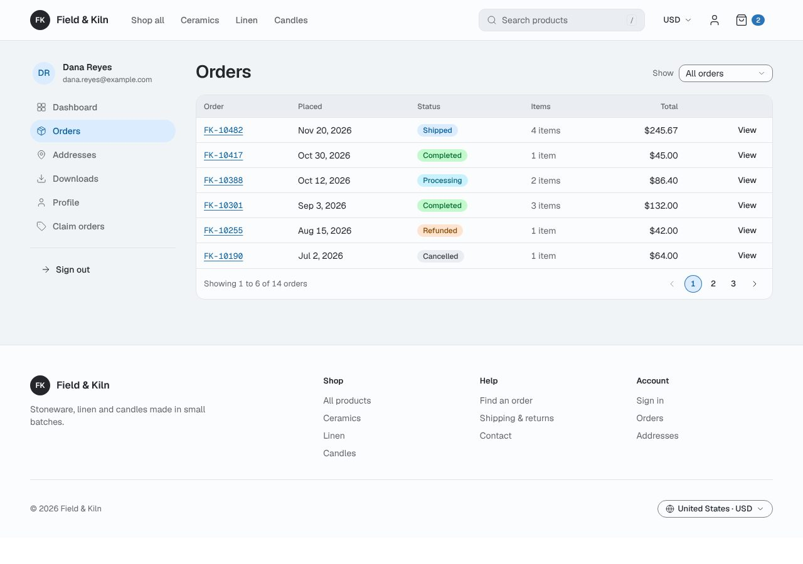

## Design

Order status as a soft badge with a consistent color per status.

**Order history**

### Spec

**Design system components:** Badge (soft)

- Processing: info. Shipped: primary (with truck icon on detail pages). Completed: success. Refunded: warning. Cancelled: neutral. Pending payment: warning.

**Accessibility**

- The status word is always shown.

**Tokens only:** every color, radius and size comes from `--apui-*` tokens and the component bundle; no DaisyUI classes.

Canvas boards: [Account-orders](https://claude.ai/code/artifact/1433c967-7beb-45a4-8e05-e2785d8f8e57#artboard-Account-orders) (part of the design for #60).
