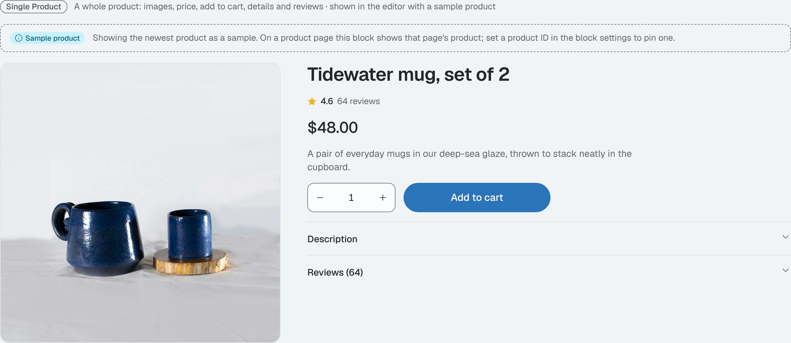
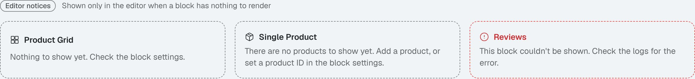
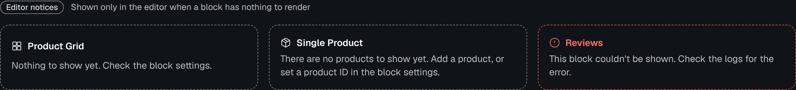

## Design

The commerce block frame in the editor: the sample notice and the empty/error notices.

**Sample product notice**

**Editor notices**

**Editor notices, dark**

### Spec

**Design system components:** Badge (soft info), Icon

- Notices use a 1px dashed `--apui-border-default` frame (error: `--apui-color-error-border`), `--apui-radius-md`/`lg`, so they never read as storefront content.
- The sample notice has an info badge ("Sample product", "Sample cart", "Multi-step") and one line of help.
- Shown only in the editor preview; the storefront renders the block alone.

**Tokens only:** every color, radius and size comes from `--apui-*` tokens and the component bundle; no DaisyUI classes.

Canvas boards: [BlocksProduct](https://claude.ai/code/artifact/1433c967-7beb-45a4-8e05-e2785d8f8e57#artboard-BlocksProduct), [BlocksCheckout](https://claude.ai/code/artifact/1433c967-7beb-45a4-8e05-e2785d8f8e57#artboard-BlocksCheckout) (part of the design for #60).
