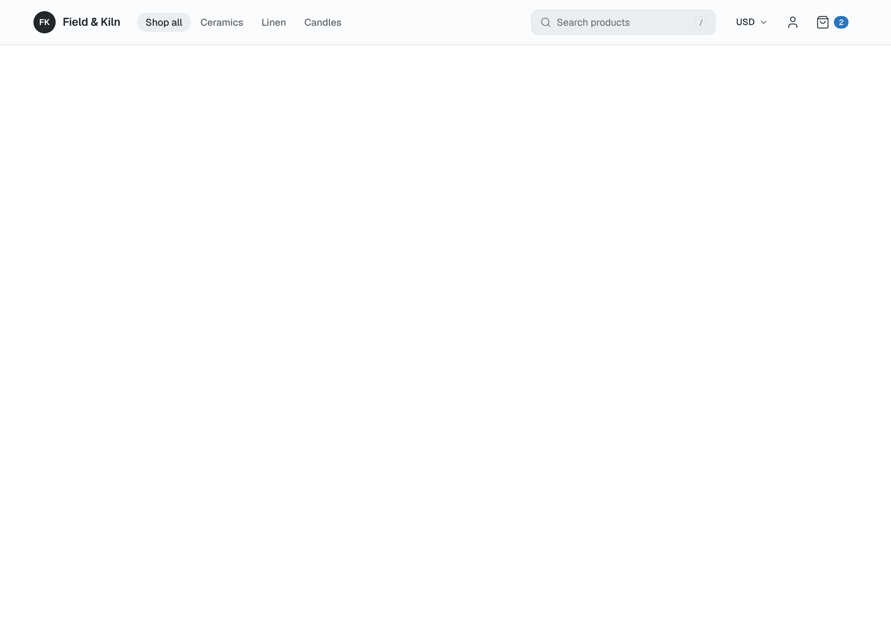
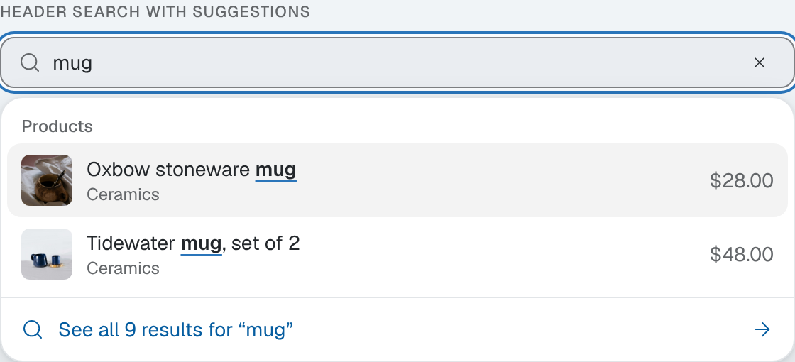
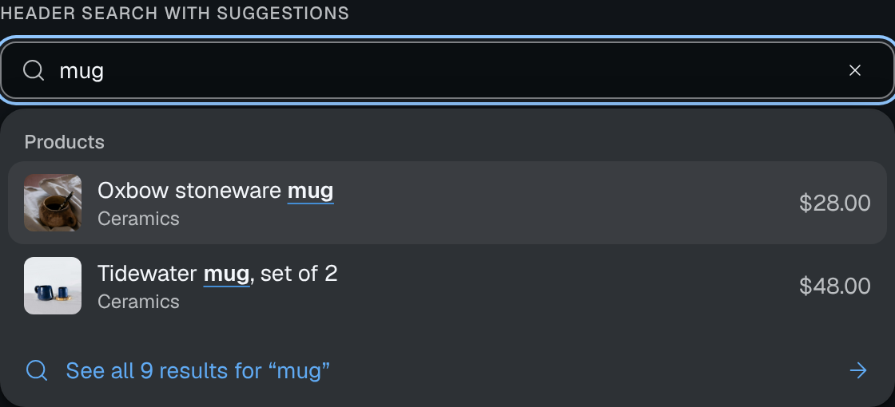

## Design

Header search box with live suggestions.

**Header**

**Suggestions, light**

**Suggestions, dark**

### Spec

**Design system components:** Input (sunken fill, kbd hint), DropdownMenu (listbox), Icon

- Desktop: up to 440px wide in the header with a "/" shortcut hint; mobile: a search icon button.
- Suggestions: product rows with a 36px thumbnail, the match underlined (`mark`), category and price; a final "See all N results" row.

**Accessibility**

- Combobox pattern: `role="combobox"`, `aria-expanded`, `aria-controls`, the active option has `aria-selected`.

**Tokens only:** every color, radius and size comes from `--apui-*` tokens and the component bundle; no DaisyUI classes.

Canvas boards: [Header](https://claude.ai/code/artifact/1433c967-7beb-45a4-8e05-e2785d8f8e57#artboard-Header), [FormsSheet](https://claude.ai/code/artifact/1433c967-7beb-45a4-8e05-e2785d8f8e57#artboard-FormsSheet) (part of the design for #60).
